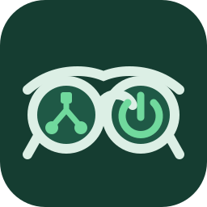
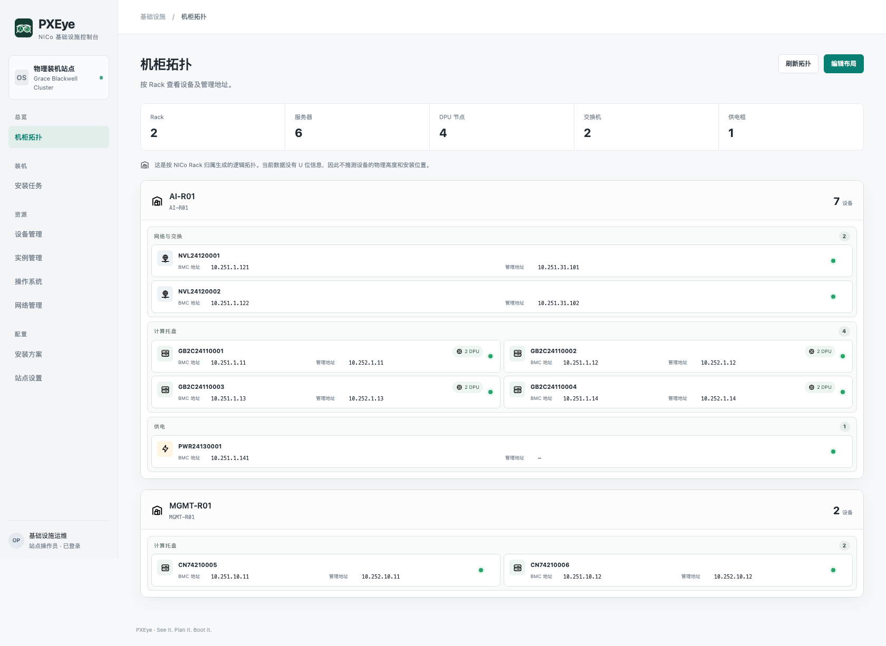
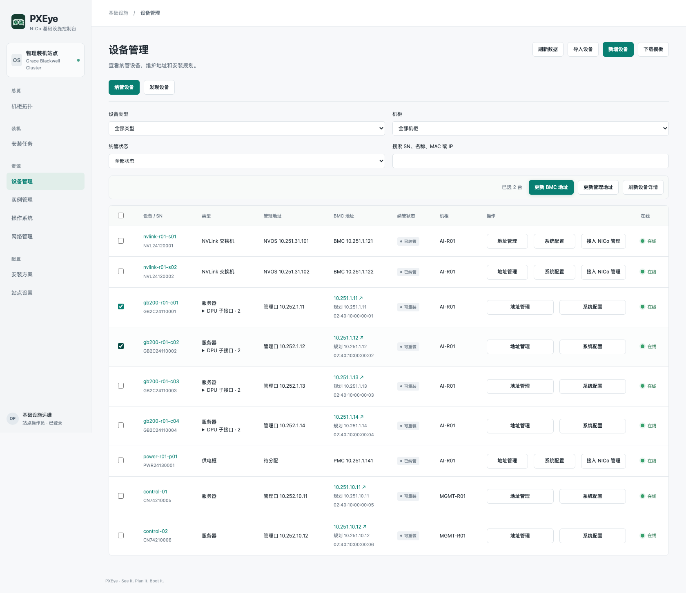
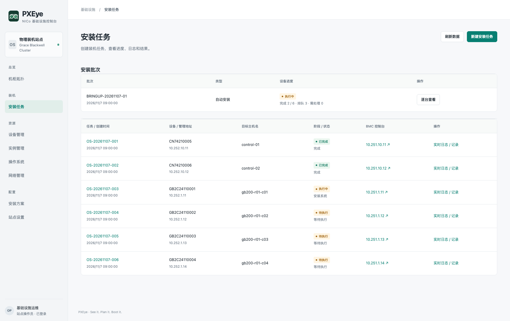

<p align="center"></p>
<h1 align="center">PXEye</h1>
<p align="center"><strong>See it. Plan it. Boot it.</strong></p>
<p align="center">A bare-metal operations console for NVIDIA Infra Controller.</p>
<p align="center"><strong>English</strong> · <a href="README.zh-CN.md">简体中文</a></p>
<p align="center"><a href="docs/features.md">Features</a> · <a href="docs/getting-started.md">Getting started</a> · <a href="docs/architecture.md">Architecture</a> · <a href="docs/README.md">Documentation</a></p>

PXEye brings device discovery, inventory, address planning and operating-system installation into one interface. Built on [NVIDIA Infra Controller (NICo)](https://docs.nvidia.com/infra-controller/documentation/home), it helps infrastructure teams move from newly arrived hardware to verified OS delivery, with explicit execution steps and persistent installation records.

PXEye is an independent community project. NICo provides the infrastructure control plane; PXEye provides the operator interface, planning resources and workflow orchestration.



*An illustrative management view inspired by GB200 NVL72, showing a subset of compute, NVLink and power equipment alongside management servers. Identifiers, addresses and task states are authored examples. The interface currently uses Simplified Chinese.*

## Why PXEye?

- **Understand the hardware.** Identify devices by serial number, inspect management endpoints and organize equipment by rack.
- **Plan before executing.** Save addresses, target systems and disk policies independently of hardware changes. Apply them through explicit operations.
- **Follow installation to completion.** Keep the effective configuration, events, console logs and acceptance results with each task. Retain failure evidence for recovery.

## Features

| Area | What you can do |
| --- | --- |
| Rack topology | View servers, DPU endpoints, NVLink switches and power shelves; persist manual device ordering. |
| Discovery and inventory | Observe DHCP endpoints, retrieve Redfish identity with shared credentials, enroll devices, and import CSV or Excel inventories. |
| Address management | Maintain planned BMC and host management addresses; update supported controllers and refresh observed details in batches. |
| Networks | Inspect NICo network segments and allocations; prepare drafts and create supported segments. |
| Operating systems | Upload or import Ubuntu ISOs from a service-accessible directory, extract boot artifacts, and register NICo OS definitions. |
| Installation profiles | Reuse disk-selection, GPT/UEFI partitioning, ext4/XFS and installation defaults; freeze resolved device settings when creating tasks. |
| Installation tasks | Prepare hardware when needed, allocate or reuse Instances, launch unattended installation, and inspect logs and OS acceptance results. |
| Instances and site | Inspect and release Instances; view Core connectivity, client identity, storage and supporting services. |

See [Features and support boundaries](docs/features.md) for native resource mappings and hardware requirements.

## Operator workflow

1. **Prepare the site:** verify NICo connectivity, DHCP relay, network segments and artifact delivery.
2. **Prepare an OS:** import an ISO, prepare boot artifacts and register its NICo definition.
3. **Identify and enroll:** discover DHCP endpoints or import inventory, retrieve hardware identity and select devices to manage.
4. **Save the plan:** choose addresses, the target OS, an installation profile and device overrides.
5. **Install and verify:** create a task, review its target and disk scope, then follow execution through SSH and normal-reboot verification.

Discovery, planning and installation have separate responsibilities. Non-server equipment uses the inventory and address workflow; PXEye does not install its OS.

## Interface

### Device management



### Installation tasks



These images share the same illustrative dataset. The [reference scenario](docs/reference-cluster.md) explains its scope and how to reproduce the captures.

## Getting started

PXEye requires an existing NICo deployment, a compatible Linux administrative client, Core mTLS credentials, persistent storage and boot artifacts reachable from the target hosts.

From the PXEye repository root:

```bash
install -m 0755 /path/to/nico-admin-cli bin/nico-admin-cli
install -m 0755 /path/to/grpcurl bin/grpcurl
make image IMAGE=pxeye:dev BASE_IMAGE=ubuntu:24.04
```

The repository includes a [site configuration example](examples/site.example.json) and a [single-replica Kubernetes manifest](deploy/kubernetes.yaml). Configure the site, credentials, storage and PXE publication paths using the [deployment guide](docs/deployment.md) before starting the service. External binaries are supplied at build time; they are not bundled in the source repository.

For a first installation, follow the [getting-started guide](docs/getting-started.md).

## Architecture and support

PXEye uses a Python HTTP backend, SQLite/WAL persistence and native JavaScript/CSS. The service serves both the UI and API; no frontend build step is required. NICo Core owns infrastructure lifecycle state. PXEye stores device plans, profiles, task snapshots, logs and display layout.

The current **technical preview** targets a single site, one service replica and a single operator, with installations executed serially. The principal physical validation path is Ubuntu Server 24.04 on x86_64 UEFI hardware. ARM64, GB200/GB300 and other OEM workflows require separate validation. Address operations depend on each device's Redfish or NVOS capabilities.

Cluster creation, workload scheduling, firmware distribution, fabric configuration and multi-tenant RBAC are outside the current product scope. See [Architecture](docs/architecture.md) and [Security](SECURITY.md).

## Documentation

All public project documentation is available in English and Simplified Chinese. Start with the [documentation index](docs/README.md) for operational guides, design references and contribution information. The [changelog](CHANGELOG.md) records capability milestones.

## Contributing

See [CONTRIBUTING.md](CONTRIBUTING.md) for development principles and change-review expectations. Include the target NICo version, device capabilities and validation scope when proposing a change. Documentation improvements and hardware compatibility reports are welcome.

## Project status and license

PXEye is a technical preview licensed under [Apache-2.0](LICENSE). Dependencies and third-party assets retain their own licenses. See [Security](SECURITY.md) for the current reporting process.
