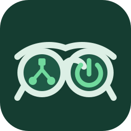
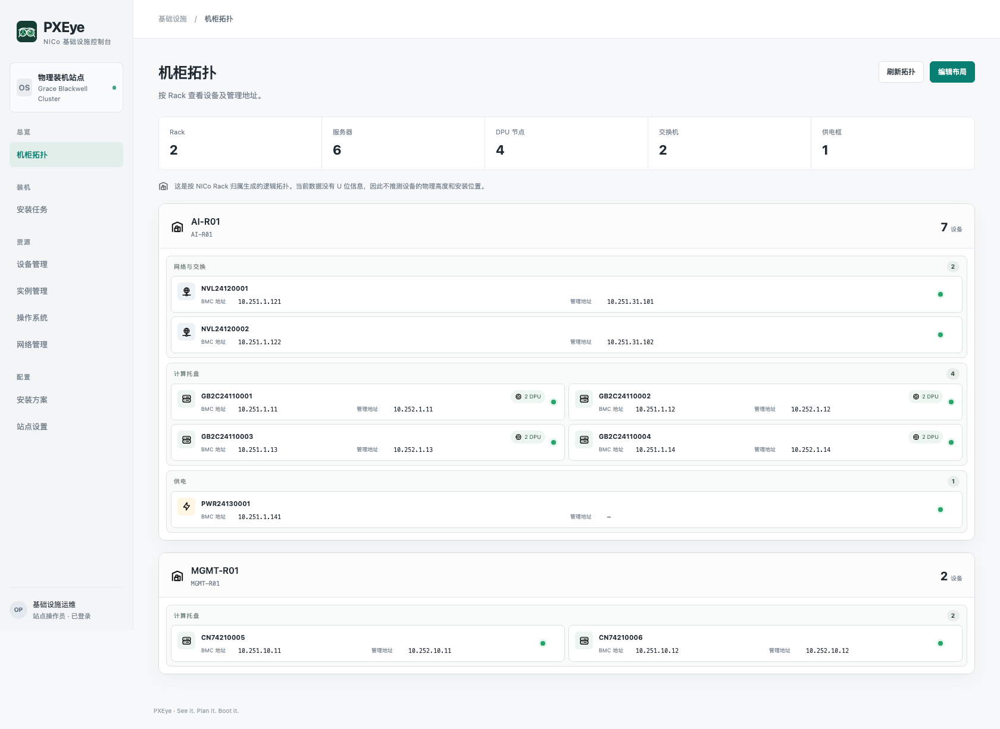
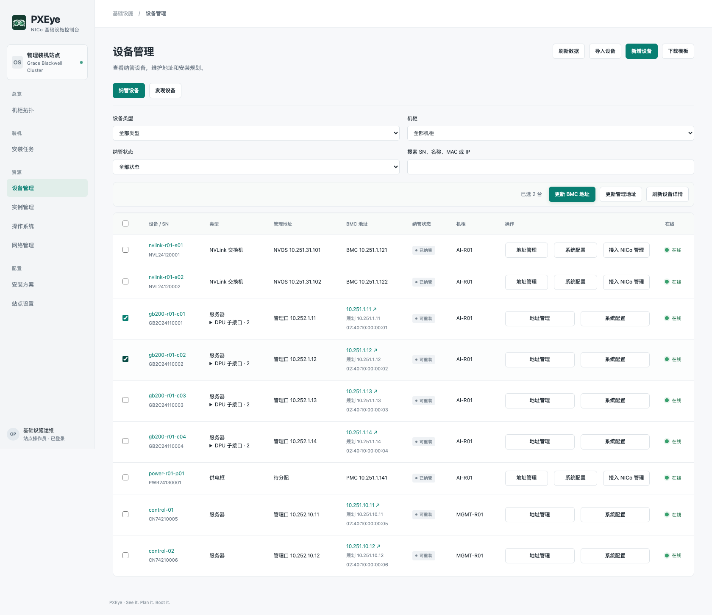
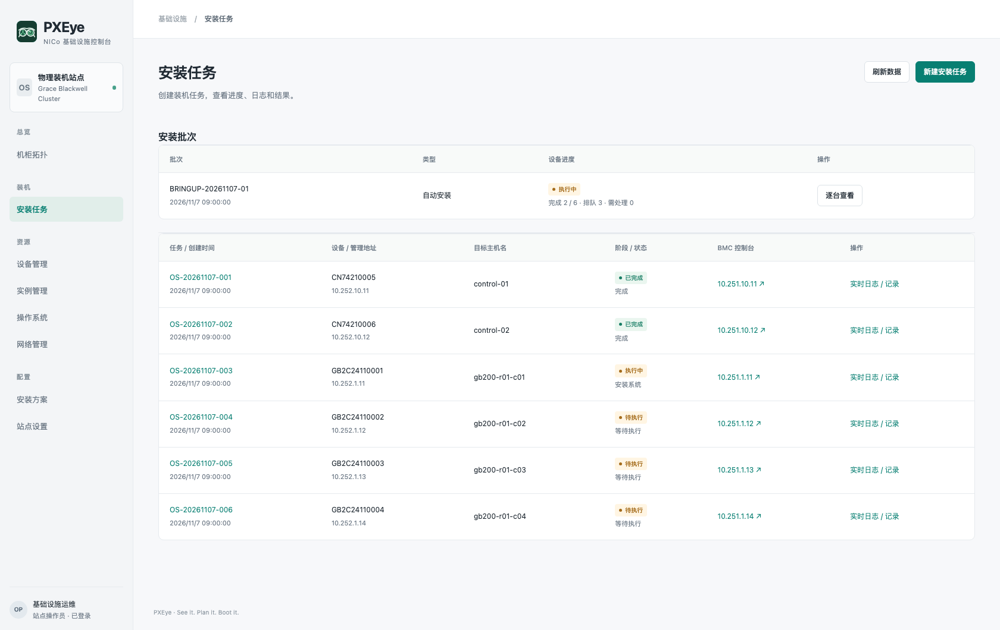

<h1 align="center">PXEye</h1>

<strong>See it. Plan it. Boot it.</strong>

基于 NVIDIA Infra Controller 的裸金属运维控制台。

<a href="README.md">English</a> · <strong>简体中文</strong>

<a href="docs/features.zh-CN.md">功能说明</a> · <a href="#快速开始">快速开始</a> · <a href="docs/architecture.zh-CN.md">系统架构</a> · <a href="docs/README.zh-CN.md">文档中心</a>

PXEye 将设备发现、清单管理、地址规划和操作系统安装整合到统一界面。它基于 [NVIDIA Infra Controller（NICo）](https://docs.nvidia.com/infra-controller/documentation/home)，帮助基础设施团队从新到货硬件走到完成验收的操作系统交付，每次执行都有明确入口和持久安装记录。

PXEye 是独立社区项目。NICo 提供基础设施控制面，PXEye 提供操作界面、规划资源和流程编排。

*参考 GB200 NVL72 的管理视图示例，展示部分计算节点、NVLink 交换机、供电设备和管理服务器。设备标识、地址和任务状态为编写的展示数据。当前界面使用简体中文。*

## 为什么使用 PXEye？

- **看清硬件。** 用序列号识别设备，查看管理端点，按机柜组织设备。
- **先规划再执行。** 独立保存地址、目标系统和磁盘策略，通过明确操作改变硬件状态。
- **跟踪装机直至完成。** 每个任务保留实际配置、事件、控制台日志和验收结果，失败时保留证据以便恢复。

## 核心功能

| 模块 | 主要能力 |
| --- | --- |
| 机柜拓扑 | 展示服务器、DPU 端点、NVLink 交换机和供电框，持久保存人工排列。 |
| 发现与清单 | 观察 DHCP 端点，用统一凭据获取 Redfish 身份，选择纳管，导入 CSV 或 Excel 清单。 |
| 地址管理 | 维护 BMC 和主机管理地址规划，批量更新受支持的控制器并刷新实际信息。 |
| 网络管理 | 查看 NICo 网络段和地址分配，准备草稿并创建支持的子网。 |
| 操作系统 | 上传或从服务可访问目录导入 Ubuntu ISO，提取引导材料，登记 NICo OS 定义。 |
| 安装方案 | 复用磁盘选择、GPT/UEFI 分区、ext4/XFS 和安装默认值，创建任务时冻结逐机配置。 |
| 安装任务 | 按需准备硬件，分配或复用 Instance，启动无人值守安装，查看日志和 OS 验收结果。 |
| 实例与站点 | 查询和回收 Instance，查看 Core 连接、客户端身份、存储和配套服务。 |

原生资源映射和硬件前提见[功能与支持边界](docs/features.zh-CN.md)。

## 快速开始

PXEye 使用已有的 NICo 控制面；先按清单准备站点，部署 PXEye，再完成一台服务器安装后扩大批次，OS 材料和设备配置可以在部署后通过界面准备。

### 开始前检查

- 已准备兼容版本的 NICo、管理客户端、Core mTLS 凭据及 PXEye 持久存储。
- 已核对目标主机序列号、CPU 架构、BMC MAC 和 PXE 接口永久 MAC。
- 已从实际控制面路径验证 BMC Redfish 身份及所需权限，并准备所选接管流程要求的凭据。
- 已确认 BMC 与主机引导网络的子网、网关、VLAN、Relay 和无冲突的地址分配方案。
- 已验证实际装机路径中的 DHCP 请求与回程，以及所需 HTTP、Core、DNS 和 NTP 服务。
- 已准备匹配目标架构的 EFI、Scout、ISO、kernel/initrd、自动安装配置及所需软件源。
- 已确认 RAID、稳定的系统盘选择规则、数据备份和允许清理的磁盘范围。
- 已配置安装材料挂载与发布地址，并准备目标系统的登录、回执和验收访问方式。

完整的发现、OS 写入及受管 DPU 分阶段检查、验证参考和交接填写栏见[装机前检查清单](docs/pre-installation-checklist.zh-CN.md)。

### 部署 PXEye

按[部署指南](docs/deployment.zh-CN.md)准备镜像、配置凭据和存储、通过 NICo PXE HTTP 发布材料并开放服务入口；仓库提供[站点配置示例](examples/site.example.json)和[单副本 Kubernetes 清单](deploy/kubernetes.yaml)，NICo 及其网络入口需另外准备。

兼容的 `nico-admin-cli` 和 `grpcurl` 是镜像构建输入，不随源码分发；具体构建命令和挂载位置统一在部署指南维护。

### 首台装机

按[首台装机指南](docs/getting-started.zh-CN.md)操作一台专用设备：准备 OS、识别纳管、保存规划、安装并验证系统盘启动、SSH 和普通重启，保存任务证据后再扩大批次。

## 操作流程

1. **准备站点：** 核对 NICo 连接、DHCP relay、网络段和材料服务。
2. **准备 OS：** 导入 ISO，提取引导材料，登记 NICo 定义。
3. **识别并纳管：** 发现 DHCP 端点或导入清单，读取硬件信息，选择需要管理的设备。
4. **保存规划：** 设置地址、目标 OS、安装方案和逐机覆盖配置。
5. **安装并验收：** 创建任务，核对目标设备和磁盘范围，跟踪执行直至 SSH 与普通重启验证完成。

发现、规划和安装各自独立。非服务器设备使用清单和地址管理流程，PXEye 不安装这些设备的 OS。

## 界面展示

### 设备管理

### 安装任务

三张截图使用同一份示例数据。[参考集群场景](docs/reference-cluster.zh-CN.md)说明了示例范围和截图生成方法。

## 架构与支持范围

PXEye 使用 Python HTTP 后端、SQLite/WAL 和原生 JavaScript/CSS。同一服务提供界面与 API，无需前端构建步骤。NICo Core 管理基础设施生命周期状态；PXEye 保存设备规划、方案、任务快照、日志和展示布局。

当前版本为**技术预览**，采用单站点、单副本、单操作员模型，安装批次支持可配置并发（默认 5 台）。主要实机验证路径是 x86_64 UEFI 硬件上的 Ubuntu Server 24.04；ARM64、GB200/GB300 和其他 OEM 流程需要独立验证。地址更新依赖设备实际提供的 Redfish 或 NVOS 能力。

集群创建、工作负载调度、固件分发、Fabric 配置和多租户 RBAC 不属于当前产品范围。详见[系统架构](docs/architecture.zh-CN.md)和[安全说明](SECURITY.zh-CN.md)。

## 项目文档

所有公开项目文档均提供英文和简体中文。操作指南、设计参考和贡献说明统一收录在[文档中心](docs/README.zh-CN.md)。[变更记录](CHANGELOG.zh-CN.md)按能力里程碑组织。

## 参与项目

开发原则和评审要求见[贡献指南](CONTRIBUTING.zh-CN.md)。提出修改时，请说明目标 NICo 版本、设备能力和验证范围。欢迎补充文档和硬件兼容报告。

## 项目状态与许可证

PXEye 当前为技术预览，采用 [Apache-2.0 许可证](LICENSE)。依赖和第三方资产保留各自许可证。安全报告流程见[安全说明](SECURITY.zh-CN.md)。
