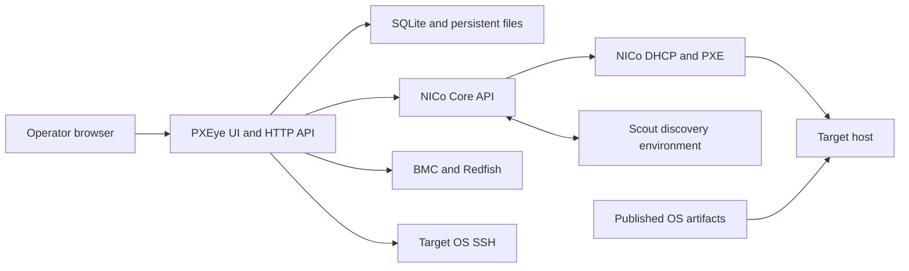

# Architecture

**English** · [简体中文](architecture.zh-CN.md) · [Documentation](README.md)

## System context

PXEye is the operator and orchestration layer. NICo owns infrastructure lifecycle state. The browser does not execute NICo commands: the Python backend invokes the compatible CLI and gRPC client in its own runtime, which is the PXEye container in the Kubernetes deployment.

The frontend and backend have separate source modules but are served by one process and deployed together. Native JavaScript and CSS need no compilation; the API uses Python's `ThreadingHTTPServer`. SQLite uses WAL, and a process lock prevents concurrent executors sharing the same data directory.

## Module responsibilities

| Responsibility | Modules under `src/pxeye/` |
| --- | --- |
| Process and composition | `__main__.py`, `bootstrap.py` |
| HTTP, sessions, CSRF, routes and safe errors | `api/http.py`, `api/queries.py`, `api/commands.py`, `api/errors.py` |
| Core, Redfish, SSH and bounded processes | `clients/`; execution facade in `services/execution.py` |
| SQLite schema, tasks, locks and idempotency | `persistence/store.py` |
| Atomic exports and value helpers | `common.py` |
| Resource, identity, CSV and topology contracts | `domain/` |
| Native declarations and networks | `services/resources.py` |
| Device projection, plans and execution revisions | `services/device_view.py`, `services/device_plans.py`, `services/device_config.py` |
| Typed equipment and address operations | `services/equipment.py`, `services/addresses.py`, `services/bmc_jobs.py` |
| Discovery, ingestion and hardware | `services/discovery.py`, `services/onboarding.py`, `services/hardware.py` |
| OS and profile lifecycle | `services/os_library.py`, `services/profiles.py` |
| Instances and current OS observations | `services/instances.py`, `services/current_systems.py` |
| Task claiming, queues, recovery and lock policy | `services/tasks.py` |
| Installer generation, disk policy, boot and acceptance | `installation/` |

Frontend modules are packaged under `src/pxeye/web/`: `shared/ui_runtime.js` owns page/action registration, event observers, hooks and polling lifecycle; `shared/live.js` supplies shared UI, API and task helpers; `pages/` holds capability modules; `main.js` registers pages and starts the application. They remain plain scripts with an explicit HTML loading order, not ES modules. Each page and action has one registered owner; dialog extensions use named helpers and hooks.

## Initialization and reads

Bootstrap injects resource, plan and profile services into the execution facade. It shares the path-keyed Store wrapper, acquires the process lock, imports legacy profiles, explicitly refreshes native inventory and delegates task recovery to the coordinator. SQLite connections remain scoped to each operation. Schema initialization is centralized in Store and records migration version 1; no existing task or plan table is removed.

Device list reads assemble a projection without seeding plans or exporting inventory. `POST /api/resources/refresh` explicitly reads NICo declarations, publishes rebuildable exports and seeds only missing plans; the device refresh button uses it. Startup also attempts that refresh, preserving saved plans when Core is unavailable. This is a local reconciliation operation and does not change NICo or hardware. Multi-call Core observations are not a transactional snapshot.

Errors return a stable `code` and `request_id`. Logs contain the request method, route, exception class and stack locations; raw command arguments, exception text and credential-bearing request bodies are omitted. Unknown write outcomes are not retried by error handling.

## Data ownership

| Information | Authoritative source |
| --- | --- |
| Machines, Instances, interfaces, network segments and OS definitions | NICo Core |
| Observed identity, power and controller networking | Hardware management interfaces |
| Scout hardware inventory | NICo discovery reports |
| Device plans, profiles and immutable task settings | PXEye SQLite |
| OS DNS used for installation | PXEye network-service configuration, frozen per task |
| ISO, kernel and initrd | Persistent artifact directory and its publication service |
| Task events, logs and acceptance evidence | PXEye persistent data directory |
| Manual rack display order | PXEye SQLite |

The planning entry owns desired values. Consumers refer to them and resolve a snapshot at execution; live readback remains separate. Editing a plan does not rewrite a running task.

## Execution model

1. Read the target, revision and impact scope.
2. Store the plan independently of execution.
3. Record whether an external write was dispatched and bound its duration.
4. Confirm the result through independent reads.
5. If the outcome is unknown, retain the operation state rather than replay it blindly.
6. Keep failure evidence for a scoped recovery action.

Installation profiles are not NICo's iPXE templates. PXEye resolves a profile and device plan into the native OS/Instance configuration and controlled installer input. Scout and the Ubuntu installer have different responsibilities: Scout performs NICo hardware preparation; autoinstall applies the selected OS partition and network configuration.

## Version compatibility

The integration was developed against a Core revision derived from `e703126e4`. Online NICo documentation can describe newer behavior. Match the administrative client to the target Core, and check API fields, built-in templates and hardware drivers before upgrading. In particular, public templated-iPXE documentation does not imply support for native in-place NetworkSegment updates in this integration.

Native concepts: [Templated iPXE OS](https://docs.nvidia.com/infra-controller/documentation/configuration-day-1/templated-i-pxe-operating-systems), [network configuration](https://docs.nvidia.com/infra-controller/documentation/provisioning-day-0/ip-and-network-configuration), [Rack state machine](https://docs.nvidia.com/infra-controller/documentation/architecture/state-machines/rack-machine-switch-power-shelf).
