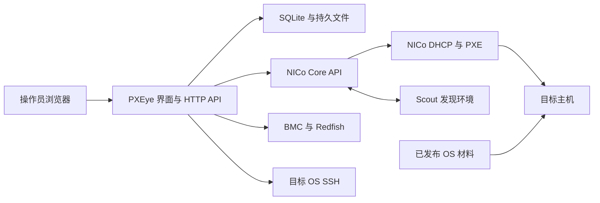

# 系统架构

[English](architecture.md) · **简体中文** · [文档中心](README.zh-CN.md)

## 系统位置

PXEye 是操作界面和编排层，NICo 管理基础设施生命周期状态。浏览器不直接执行 NICo 命令；Python 后端在自己的运行环境调用兼容的 CLI 和 gRPC 客户端，Kubernetes 部署中对应 PXEye 容器。

前后端源码分模块，同一进程提供服务、统一部署。原生 JavaScript/CSS 不需要编译，API 使用 Python `ThreadingHTTPServer`。SQLite 启用 WAL，进程文件锁阻止共享数据目录中同时运行多个执行器。

## 模块职责

| 职责 | `src/pxeye/` 下的模块 |
| --- | --- |
| 进程入口与组装 | `__main__.py`、`bootstrap.py` |
| HTTP、会话、CSRF、路由与安全错误 | `api/http.py`、`api/queries.py`、`api/commands.py`、`api/errors.py` |
| Core、Redfish、SSH 与有时限进程 | `clients/`；执行组合层为 `services/execution.py` |
| SQLite 表结构、任务、锁与幂等 | `persistence/store.py` |
| 原子导出与公共值工具 | `common.py` |
| 资源、身份、CSV 与拓扑契约 | `domain/` |
| 原生声明与网络 | `services/resources.py` |
| 设备视图、规划及执行版本 | `services/device_view.py`、`services/device_plans.py`、`services/device_config.py` |
| 设备类型与地址操作 | `services/equipment.py`、`services/addresses.py`、`services/bmc_jobs.py` |
| 发现、接入与硬件 | `services/discovery.py`、`services/onboarding.py`、`services/hardware.py` |
| OS 与方案生命周期 | `services/os_library.py`、`services/profiles.py` |
| 实例与当前系统观测 | `services/instances.py`、`services/current_systems.py` |
| 任务认领、队列、恢复与锁策略 | `services/tasks.py` |
| 安装器生成、磁盘策略、启动与验收 | `installation/` |

前端随包位于 `src/pxeye/web/`：`shared/ui_runtime.js` 管理页面/操作注册、事件观察器、钩子与轮询生命周期；`shared/live.js` 提供公共 UI、API 和任务工具；`pages/` 保存功能模块；`main.js` 注册页面后启动。仍使用 HTML 明确加载顺序的普通脚本，并未改为 ES modules。每个页面和操作只有一个注册归属，弹窗扩展使用具名工具和钩子。

## 初始化与读取

启动组装向执行组合层注入资源、设备规划和方案服务，复用按路径缓存的 Store 包装器，获取进程锁，导入历史方案，显式刷新原生清单，再将任务恢复交给协调器。SQLite 连接仍按操作打开与关闭。表结构初始化集中在 Store，记录迁移版本 1，不删除既有任务或规划表。

设备列表读取只组装视图，不补录规划或导出清单。`POST /api/resources/refresh` 显式读取 NICo 声明、发布可重建导出并仅补录缺失规划；设备刷新按钮调用此入口。启动时也尝试刷新，Core 不可用时保留已保存规划。这是本地协调，不修改 NICo 或硬件。多次 Core 调用组成的观测并非事务快照。

错误返回稳定的 `code` 和 `request_id`。日志包含请求方法、路由、异常类型与堆栈位置，省略原始命令参数、异常文本和含凭据的请求内容。错误处理不自动重试结果未知的写入。

## 数据归属

| 信息 | 事实来源 |
| --- | --- |
| Machine、Instance、接口、网络段、OS 定义 | NICo Core |
| 实际身份、电源和控制器网络 | 硬件管理接口 |
| Scout 硬件信息 | NICo 发现报告 |
| 设备规划、安装方案、不可变任务设置 | PXEye SQLite |
| 安装所用 OS DNS | PXEye 网络服务配置，按任务冻结 |
| ISO、kernel、initrd | 持久材料目录及发布服务 |
| 任务事件、日志和验收证据 | PXEye 持久数据目录 |
| 人工机柜排列 | PXEye SQLite |

规划入口维护期望值，使用方引用数据并在执行时解析为快照，实际读回值独立保存。修改规划不会重写运行中的任务。

## 执行模型

1. 读取目标、版本和影响范围。
2. 规划独立保存。
3. 记录外部写入是否已发送，并限制执行时间。
4. 通过独立读取核对结果。
5. 结果未知时保留状态，不盲目重复写入。
6. 为限定范围的恢复动作保留失败证据。

安装方案不同于 NICo iPXE 模板。PXEye 将方案与逐机规划解析成原生 OS/Instance 配置及受控安装器输入。Scout 与 Ubuntu 安装器职责不同：Scout 执行 NICo 硬件准备，autoinstall 应用所选 OS 分区和网络配置。

## 版本兼容

当前集成基于 `e703126e4` 派生 Core 开发，在线文档可能描述更新能力。管理客户端与目标 Core 版本匹配，升级前核对 API 字段、内置模板和设备驱动。公开模板化 iPXE 说明不意味着当前集成支持原生 NetworkSegment 原位修改。

原生概念见[模板化 iPXE OS](https://docs.nvidia.com/infra-controller/documentation/configuration-day-1/templated-i-pxe-operating-systems)、[网络配置](https://docs.nvidia.com/infra-controller/documentation/provisioning-day-0/ip-and-network-configuration)和 [Rack 状态机](https://docs.nvidia.com/infra-controller/documentation/architecture/state-machines/rack-machine-switch-power-shelf)。
