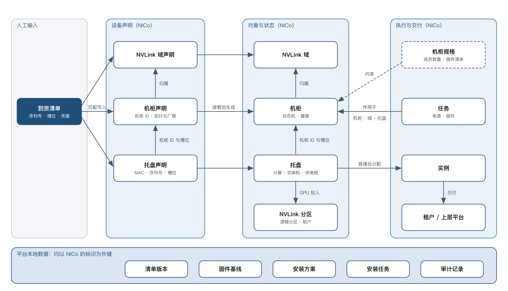

# Rack-level infrastructure management and provisioning platform: design specification

**English** · [简体中文](whole-rack-operations.zh-CN.md) · [Design documents](README.md)

The design of whole-rack operations for GB200 / GB300, built on NVIDIA Infra Controller (NICo).

- Status: design draft, for design review. This document describes the target design, not implemented functionality; the application code on this branch still has the first-version pages.
- The page-level design is in the [frontend design](frontend/README.md): every page can be clicked through and carries its feature points.
- The interface is in Simplified Chinese. Menu and page names are quoted in Chinese, with an English gloss in parentheses where they first appear. The figures are labelled in Chinese.

## 1. Purpose

This document gives the overall design of the rack-level infrastructure management and provisioning platform (PXEye): the platform architecture, the end-to-end operations workflow, what each module is for and which resources it owns, how modules interact and depend on each other, the design of operations, and the non-functional design. It is the common basis for interface design, work breakdown and acceptance testing.

Its chapters correspond one to one with the [requirements specification](../archive/rack-operations-v1/design/rack-operations-requirements.md): the requirements say which capabilities are wanted, and this document says how the platform organises them. The target hardware is the NVIDIA GB200 / GB300 NVL72 whole rack, and the foundation is NVIDIA Infra Controller (NICo).

## 2. Design goals

- NICo is the source of truth and the execution engine: once a device is written to NICo, its state is what NICo says. The platform adds the interface, the arrival inventory, the matching of devices to the inventory and the gating of operations, and does not rebuild what NICo already provides.
- The rack is the unit of operation (one NVL72 rack is one NVLink domain): turn one arrival inventory into deliverable racks, and keep the racks deliverable while they run.
- Device data has a single manual input: the arrival inventory, which gives the rack, slot, serial number and device credentials. MAC addresses, IP addresses and models come from discovery; site-level configuration is prepared once at deployment and checked item by item by the platform.
- An operation takes at most three inputs: object, action, reason. Order, timeouts and retries are decided by site-level rules and are not filled in per operation.
- Every write operation can be previewed, tracked and audited; an unknown result is never resent automatically.
- Critical safety interlocks stay with the facility. The platform does not replace them and only refuses an operation when it detects a risk.

## 3. Scope and boundaries

### 3.1 In scope

- Inventory, discovery and state management of racks, NVLink domains, compute trays, switch trays (NVLink switches) and power shelves.
- Tracking the progress of rack bring-up and running it again after a failure; power on and off of racks and trays, firmware updates, maintenance, quarantine, replacement and decommissioning.
- Operating system installation and instance delivery, and handing ready machines to an upper-layer platform.
- A health summary of racks, domains and trays, with entry points for handling alerts.
- Profiles such as firmware baselines and installation profiles, and the audit of every write operation.

### 3.2 Out of scope

- Closed-loop control on the facility side, such as circuit breakers and coolant valves; the building management system (BMS) owns it.
- Configuration of devices NICo does not manage, such as access switches and rack PDUs.
- Storing and displaying time series such as metric curves, power and temperature; the monitoring system owns them, and the platform only links to it.
- Cluster assembly and workload scheduling, such as Kubernetes and SLURM; the upper-layer platform owns them.
- Adapting to hardware that is not a whole rack or to non-standard networks; these do not enter the main flow.
- Deployments in which NICo manages the DPUs (DPU mode). In this version the BlueField cards of a compute tray are used as network cards only; DPU mode is left to a later phase.
- Power and firmware operations at the level of an NVLink domain, and phased firmware rollout across racks.

## 4. Architecture

### 4.1 Layers and responsibilities

| Layer | Component | Main responsibility | Key objects |
| --- | --- | --- | --- |
| Operator interface | PXEye | Inventory import, reading device identity and matching it to the inventory, gating of operations, task tracking, audit, profiles | Arrival inventory, device credentials held temporarily, profiles, audit, installation tasks |
| Orchestration | NICo REST and Flow | Orders rack-level power and firmware operations in steps by operation rules and persists tasks; powers a rack off automatically on a rack-level leak | Tasks, operation rules |
| Facts and state | NICo Core | Device declarations, probing and ingestion, the state machines (rack bring-up is run by the rack state machine on its own), health, subnets and addresses, OS definitions and instances | Racks, domains, trays, NVLink partitions, instances |
| Hardware backend | RMS (Rack Management Service) | Carries out power, reset and firmware on trays, switches and power shelves | Hardware protocols and per-device ordering |
| Interconnect | NMX-C | Forms and partitions NVLink domains | NVLink domains, partitions |
| Boot | NICo DHCP, PXE, Scout | Address assignment, network boot, hardware discovery and preparation | Leases, boot artifacts |
| Facility | BMS, DSX Exchange | Leak events, breaker and coolant valve interlocks | Leak events |
| Observability | Prometheus, Grafana, Loki | Metrics, logs | Curves, logs |
| Upper layer | NVKE, CAPNICo, tenant platforms | Receive ready machines and assemble clusters | Clusters, nodes |

### 4.2 Access paths

The platform reaches NICo through two paths, with one rule: a power or firmware operation that must be ordered across several devices goes through a Flow task, and everything else goes to Core. Rack bring-up is not submitted by the platform; Core's rack state machine runs it on its own.

| Path | Used for | Why |
| --- | --- | --- |
| NICo REST and Flow | Power on and off and firmware of racks and trays, expected-versus-actual validation, querying and cancelling tasks | Flow orders the work by operation rules and persists the task; the platform does not orchestrate the order itself |
| NICo Core | All reads; device declarations; running rack maintenance again; maintenance marks, quarantine, validation and decommissioning of a single device; OS definitions and instances | Single-object operations, with no ordering problem |

One access does not go through NICo: after a device is powered on and has an address, the platform reads its BMC once with the credentials from the arrival inventory to get the device type, serial number and model, and uses them to match the inventory. Apart from that the platform does not access devices directly.

### 4.3 Dependencies

| Component | Role | Required |
| --- | --- | --- |
| NICo Core, REST, Flow | Foundation | Yes |
| RMS | Whole-rack hardware backend | Yes |
| NMX-C | NVLink domains | Yes |
| Temporal, PostgreSQL | Workflow engine and state storage | Yes |
| Vault, cert-manager, External Secrets, MetalLB | Credentials, certificates, service addresses | Yes |
| Rack validation service (RVS) | Validation before a rack becomes ready | As the NICo state machine requires |
| BMS and DSX Exchange | Facility-side leak events | Recommended for liquid-cooled sites |
| Prometheus, Grafana, Loki | Metrics and logs | Recommended |

The platform does not configure the internal parameters of these components. It does three things: installs them from a fixed list at deployment; checks on the site page whether they are ready; and when one is missing, shows the operations that depend on it as unavailable, with the reason.

## 5. Operations workflow

Site readiness and network planning are preparation: site readiness is done once, and network planning is extended when subnets are added. After that the main line has seven stages, each with one entry point and one completion condition. Rack bring-up is run by NICo on its own and needs no one to start it.

| Stage | Target state | Main activities | Completion condition |
| --- | --- | --- | --- |
| Site readiness | The platform and its dependencies are usable, and the site configuration is complete | Deploy the control plane and check each component; check the site preparation item by item: how the BlueField cards are used, storing switch NVOS credentials, rack profiles, firmware lists, DNS subdomains | Every dependency on the site page is ready, and every site preparation item is met |
| Network planning | Every kind of device interface has a usable subnet | Plan the three kinds of subnet (out-of-band management, switch system management, host management) and their DHCP pools; confirm that gateways and DHCP relay are configured on the switches | The plan check passes: every purpose has a subnet, every subnet has a subdomain, and the assignable addresses are no fewer than the interfaces of the racks in the inventory need |
| Inventory import | The platform holds the complete arrival inventory | Upload the arrival inventory (rack, slot, device type, serial number, device credentials) and choose the rack topology and manufacturer; the platform validates it, shows the difference, and saves it after confirmation. Nothing is written to NICo yet | The inventory is saved, the rack profile is derived, and the credentials are complete |
| Onboarding | Every device in the inventory is written to NICo and ingested | Power on; once a device has an address, the platform reads its identity, matches the inventory by serial number and writes the declaration to NICo; NICo probes and ingests it. People handle only the endpoints that do not match: authentication failures, and serial numbers the inventory does not contain | The number of ready switches reaches what the rack profile requires; no device in the inventory is still absent, or the missing ones are confirmed |
| Rack bring-up | The rack is deliverable | NICo runs it on its own: once the switches are all there it goes through firmware upgrade, NVOS update, NMX-C cluster configuration, power sequence and rack validation in turn. When it stops in Error, a person removes the cause and runs rack maintenance again | The rack state is Ready and the NVLink domain is formed |
| Delivery | Machines become usable resources | Choose a rack or a set of machines, and an installation profile or a tenant; install and accept, or hand over to the upper-layer platform | Instances are ready and accepted, or the upper-layer platform has received them |
| Running | State stays observable | Watch the health and alerts of racks, domains and trays; handle the items marked as needing attention | No unhandled critical alert |
| Maintenance and change | Deliverable again after the change | Power, firmware update, maintenance, quarantine, tray replacement; the platform checks the impact and tracks the task | The task succeeds and the rack returns to Ready |
| Decommissioning | The device leaves safely | Confirm there is no instance; release, clean, decommission, and remove from the inventory | The object is decommissioned and the audit is closed |

How rack states map to stages: no object in NICo yet, and Discovering, belong to onboarding; Maintenance (with its current stage) and Validating belong to bring-up; Ready belongs to delivery and running; Error needs a person to remove the cause and run rack maintenance again. Pages show NICo's state verbatim, and the stages are used for navigation only.

## 6. Module design

The platform has seven modules by responsibility. Every resource has a single place where it is maintained; other modules only refer to it.

| Module | Purpose | Resources it owns | Requirement chapters |
| --- | --- | --- | --- |
| Site | Whether the platform itself is usable | Site connection, component readiness | 6.6 |
| Network | Which subnet each kind of device interface uses, and whether DHCP is working | Nothing local; subnets, pools and address assignments are in NICo | 6.6 |
| Inventory | The arrival inventory and how it corresponds to NICo's device declarations | Inventory versions, rows waiting to be matched, device credentials held temporarily | 6.1, 6.2 |
| Rack | The full lifecycle of racks and NVLink domains | Nothing local; everything is in NICo | 6.1, 6.2, 6.3, 6.4, 6.10 |
| Delivery | Turn ready machines into usable resources | Installation tasks and acceptance records | 6.5, 6.9 |
| Health | What is wrong now, whom it affects, where to handle it | Nothing local | 6.7 |
| Profiles and audit | Reusable choices, and who did what | Firmware baselines, installation profiles, operation audit | 6.4, 6.8 |

### 6.0 Navigation

Modules describe responsibilities; the menu describes entry points. The menu goes straight to objects: an operator who wants the address or firmware of a switch, or wants to power it, enters that device type from the menu without first finding which rack it is in. The rack page is the view that relates and summarises: from a rack you see all its members, its bring-up progress and the rack-level operations, and from a device's rack and position you get back to the rack.

| Menu group | Menu item | Submenu | Module |
| --- | --- | --- | --- |
| 运维 (Operations) | 机柜管理 (Racks) | — | Rack |
| 运维 | NVLink 域管理 (NVLink domains) | — | Rack |
| 运维 | 设备管理 (Devices) | 计算托盘 (Compute trays), 交换机 (Switches), 供电框 (Power shelves) | Rack |
| 运维 | 健康告警 (Health alerts) | — | Health |
| 运维 | 运维任务 (Operation tasks) | — | Rack |
| 运维 | 操作审计 (Operation audit) | — | Profiles and audit |
| 交付 (Delivery) | 机柜交付 (Rack delivery), 安装任务 (Installation tasks), 实例管理 (Instances) | — | Delivery |
| 接入 (Onboarding) | 网络规划 (Network planning) | — | Network |
| 接入 | 设备清单 (Device inventory) | — | Inventory |
| 接入 | 设备发现 (Device discovery) | — | Rack |
| 配置 (Configuration) | 站点设置 (Site settings) | — | Site |
| 配置 | 固件基线 (Firmware baselines), 安装方案 (Installation profiles) | — | Profiles and audit |

The three onboarding items are in the order they are used: plan the subnets, import the device inventory, then watch device discovery after power-on.

The menu has four groups, and only 设备管理 has a submenu, which can be collapsed. Menu names are formal four-character names, and page titles equal the menu names. A number on a menu item is always the count that needs attention. In the interface the three device types are collectively “设备” (devices); “计算托盘” (compute tray) is only the name of one type.

Interface text is Chinese throughout and does not join an English abbreviation with Chinese into one term: 安装方案, 交换机, 机柜上线, 就绪, 序列号, 开机 and 关机. Only product and component names (such as NICo, NVLink, RMS, BMC, DPU) and the state values reported by NICo state machines stay in their original form.

### 6.1 Site

- Shows whether NICo Core, Flow, RMS, NMX-C, the workflow engine and storage are ready.
- Site preparation: what must be configured before devices arrive, each with its current value, the requirement, and what happens when it is not met. The items are how the BlueField cards are used (this version requires network-card mode), storing switch NVOS credentials, rack profiles, the firmware list of each rack profile, DNS subdomains, NVLink partitioning and rack validation. They are NICo's site configuration; the platform reads and checks them and does not change them from a page.
- Subnets, DHCP and boot service addresses are not maintained here; see 6.7 Network.
- Shows the operation rules in use for power, firmware and leak handling: the site's own rules, or NICo's built-in defaults.
- When a component is not ready, the operations that depend on it are shown as unavailable across the platform, with the reason.

### 6.2 Inventory

- The arrival inventory is the only manual input of device data. It comes from DCIM or the shipping list: one table, one row per device, covering all three tray types.
- The inventory gives the rack, slot, device type, serial number and device credentials. It does not require MAC or IP addresses: a shipping list usually has no MAC addresses, and the MAC is obtained from DHCP after the device is powered on.
- A row has two states. After import it is “待匹配” (waiting to be matched) and is held by the platform only, because NICo keys a device declaration by the MAC of the BMC. When the device is powered on, the platform reads its serial number and matches a row; the declaration is then written to NICo with the MAC, credentials, rack and slot, and the row becomes “已写入 NICo” (written to NICo).
- An import is a whole-table difference: it shows what is added, changed and removed, and saves after confirmation. Removing a device that has an instance or a task in progress is refused.
- The rack profile is derived from the rack topology and rack manufacturer chosen at import; the import preview reports an error when the site has not configured that profile.
- Device credentials: a device uses the values in its own row, or the batch defaults entered at import when the row leaves them empty. A switch needs NVOS credentials as well as BMC credentials. A password is submitted once and held encrypted; it never appears on a page, in a version record or in the audit. After the declaration is written to NICo the credentials are NICo's, and the platform no longer keeps them.
- Inventory files are versioned, and the password columns are removed before a file is kept.

Columns of the arrival inventory:

| Column | Meaning | Required |
| --- | --- | --- |
| rack | Rack ID, using the DCIM identifier | Yes |
| slot | Slot in the rack | Yes |
| type | compute, switch, power_shelf | Yes |
| serial | Device serial number, the only thing a device is matched by | Yes |
| location | Physical location of the rack | No |
| bmc_user, bmc_password | User name and password of the device BMC; the batch default is used when empty | No |
| nvos_user, nvos_password | User name and password of the switch NVOS; the batch default is used when empty | No |

The import also asks for the rack topology and rack manufacturer (together they decide the rack profile) and for the batch default credentials.

### 6.3 Racks and devices

The same objects can be entered in two ways: through the rack to see how they relate, or through the device to operate it directly.

| View | Question it answers | Content |
| --- | --- | --- |
| Racks | Which step of the flow each rack is in, and which members it has | The rack list; the rack detail has NICo's bring-up progress, the inventory check, the rack elevation, tasks, health and history, and the rack-level operations |
| NVLink domains | Whether a domain is formed, and which partitions it has | For each domain: whether NMX-C is reachable, the domain health, the number of switches whose Fabric Manager is healthy, and the NVLink partitions with their tenants. Read-only |
| Devices | How the device I am looking for is doing | Search across types (serial number, address, MAC, instance); the devices that need attention |
| Compute trays, switches, power shelves | The addresses, state and firmware of one device type, and which ones have problems | One list per type, with addresses and firmware versions in the table; power and other operations from the row, with batch support |
| Device discovery | How far the devices in the inventory have got, and which ones do not match | The endpoints waiting to be handled, with a way to handle each; the progress of every row of the inventory |
| Tasks | How far rack-level power and firmware operations have got | The steps and results of all Flow tasks |

- The default home page is the rack list. It contains every rack in the inventory; a rack that has no object in NICo yet is shown as “尚未建立” (not created yet). Rack objects are not created by hand: NICo creates one when the first member device is ingested.
- One NVL72 rack is one NVLink domain, so there are no domain-level power or firmware operations. A domain has two identifiers: the rack group ID from the inventory, and the domain ID reported by NMX-C after rack bring-up. The page shows both.
- Device discovery has five steps: obtain an address (NICo DHCP), read the identity (the platform reads the device BMC with the credentials from the inventory), match the inventory (by serial number), write the declaration (the platform writes to NICo), probe and ingest (NICo). A device that matches needs no confirmation. People handle only the endpoints that do not match: on an authentication failure, give that endpoint its own credentials and retry; when the inventory has no such serial number, replace a row of the inventory (a factory replacement part) or add the device to the inventory. Reading the identity never tries one password after another, so that a device does not lock its login.
- Rack bring-up is run by NICo's rack state machine on its own. It starts when the number of ready switches reaches what the rack profile requires, and goes through firmware upgrade, NVOS update, NMX-C cluster configuration, power sequence and rack validation. The page shows the current stage; it offers no “start bring-up” and no cancel. When any stage fails the rack stops in Error and does not recover by itself even after the cause is gone; rack maintenance has to be run again from the page.
- Inventory check: the rows of the inventory whose serial number no device has reported yet. It is advice only and does not hold bring-up back: bring-up does not start while switches are missing, and a missing compute tray or power shelf does not affect bring-up and only leaves an alert that the rack has fewer members than its profile.
- Rack-level operations: power on, power off, restart, firmware update, expected-versus-actual validation, decommissioning, and running rack maintenance again when the rack has stopped in Error. A rack object has no power state, so the page shows how many of its members are powered on.
- Device-level operations: power on, shut down, restart, firmware update, maintenance mark, quarantine, on-demand hardware validation, BMC restart, replacement, decommissioning. The available actions differ by type, and all of them use the same operation dialog.
- Device running state: running state, health alerts, firmware compared with the baseline, state timeline. A compute tray also has its instance, BlueField cards, hardware capabilities and LLDP neighbours; a switch also has NVOS management ports and Fabric Manager. A power shelf has no readable firmware version or power figures, so only its address, state, health and power are shown.
- Open: whether compute trays need to be released by the platform during bring-up. It will be decided after measurement.

### 6.4 Delivery

- What is delivered is a rack or a set of ready machines. The default is a whole rack as one batch, without per-machine configuration.
- Two ways to deliver: choose an installation profile, install and accept; or hand the ready machines to a tenant or an upper-layer platform.
- Installation uses NICo's DHCP, PXE and templated OS. The installation process and the acceptance result are kept per task.
- Release goes through NICo's cleaning and re-validation; a machine is not shown as deliverable until cleaning has finished.
- Delivery is possible when the rack is Ready, the NVLink domain is formed, and there is no rack-level leak. A compute tray with an alert that prevents allocation (a maintenance mark is one) is left out individually and does not hold back the rack.

### 6.5 Health

- Summarises the current health alerts of racks and the three tray types, grouped by alert or by object, and marks two classes: prevents allocation, and rack-level leak. Alert identifiers and classes are NICo's own.
- “需要处理” (needs attention) uses NICo's signals only: the state machine failed to process, or there is a health alert.
- When no report has been received the page shows “未报告” (not reported), never healthy.
- “阻止分配” (prevents allocation) affects only the host it is on: that host is not allocated to a new instance. A host with a maintenance mark is in this class too. It does not mean the rack has a problem.
- Leaks have two levels. A tray-level leak is reported by the device's sensor. On a rack-level leak NICo forces every device of the rack off on its own and refuses to power it on again; the devices do not power on by themselves after the alert clears. The page shows this automatic power-off and the affected instances as they are. The site page says so when facility-side events are not connected.
- When a rack has fewer members than its profile there is a rack-level alert that counts by device type, names no slot, and does not prevent allocation.
- Curves, power and temperature link to the monitoring system; the pages do not rebuild them.

### 6.6 Profiles and audit

- Firmware baseline: a set of versions bound to a rack profile, corresponding to the firmware list the site configures for that profile. A firmware update can only choose a baseline, never an arbitrary version. NICo can only tell whether a device's version equals the baseline, not which is newer; NVOS and power shelves have no readable installed version.
- Installation profile: reusable system, disk and login defaults. Delivery can only choose a published profile.
- Audit: every write operation records the operator, object, action, reason, task number and the state read back. Records are append-only and never deleted.
- Roles: read-only cannot run operations; operator can run device, rack and delivery operations; administrator can also change the site, the network and installation profiles. Once the site's identity system is connected, the audit records a person.

### 6.7 Network

Subnets must be planned before the device inventory is imported. A device is discovered only after it gets an address according to the plan when it is powered on.

Device interfaces fall into three purposes, and each purpose has at least one subnet:

| Purpose | Device interfaces | NICo network type | Notes |
| --- | --- | --- | --- |
| Out-of-band management | The BMCs of compute trays, switches and power shelves, and the BMCs of the BlueField cards in compute trays | Underlay | The entry point of device discovery: once these interfaces have an address, the platform reads the device identity |
| Switch system management | The NVOS management ports of a switch, two per switch | Underlay | Configuration and management of a switch after ingestion |
| Host management | Compute tray host interface | HostInband | Network boot, installation and system management of the host. In this version the BlueField cards are in network-card mode, and the host gets its address from this subnet directly |

- Plan check: every purpose has a subnet, every subnet has a subdomain, and the assignable addresses are no fewer than needed. The need is counted by interface, not by device: one BMC per device, two more NVOS management ports per switch, and one per BlueField BMC when it is connected to the out-of-band network. The device inventory cannot be imported while the check fails; the import preview counts the new racks in.
- Subnet: name, purpose, prefix, gateway, subdomain, DHCP pool, assigned and assignable. A subnet without a subdomain hands out no addresses. Only the DHCP pool of an existing subnet can be changed. The purpose and the switch-side VLAN are recorded by the platform; a NICo subnet has neither.
- DHCP service: a whole-rack site uses NICo DHCP only. For each subnet the page shows when an address was last handed out and how much of the pool is used, and marks a subnet that has never handed one out. The boot service addresses (network boot, installation material, DNS, NTP) are maintained here.
- Address assignment: which interface of which device each address was given to, and the allocation type NICo reports (dynamic, fixed, reserved). The allocation type is decided per device; it is not a property of the subnet and is not set by hand. Addresses that belong to no device yet are handled in device discovery.
- The platform only creates subnets and pools in NICo and does not configure switches. The VLAN, gateway and DHCP relay of each subnet are site prerequisites.

## 7. Resources and state model

### 7.1 Resources and ownership

| Resource | Source | Identifier | Maintained in |
| --- | --- | --- | --- |
| Arrival inventory | Imported by hand | File version; each row is identified by its serial number | Inventory |
| Device credentials | The arrival inventory or the batch defaults | — | Inventory; the platform no longer keeps them once the declaration is written to NICo |
| Device declarations (rack group, rack, tray) | Written to NICo by the platform after a device matches the inventory by serial number | Rack ID, BMC MAC, serial number | Device discovery |
| Rack | Created by NICo when the first member device is ingested | Rack ID | Read-only; operations are in the rack module |
| NVLink domain | NICo and NMX-C | Rack group ID; the domain ID reported by NMX-C | Read-only |
| NVLink partition | NICo | Partition ID | Read-only; created in delivery |
| Compute tray, switch, power shelf | Discovered and ingested by NICo | NICo object ID, serial number | Read-only; operations are in the rack module |
| Rack profile | NICo's site configuration, derived from the rack topology and manufacturer in the inventory | Profile ID | Read-only |
| Task | Flow | Task ID | The task view of the rack module |
| Instance | NICo | Instance ID | Delivery |
| Firmware baseline, installation profile | Profiles | Name and version | Profiles and audit |
| Audit record | The platform | Record ID | Read-only |

Relationship rules:

- Membership has one key: the rack ID. A slot has one source: the arrival inventory. A device is matched by one thing: its serial number.
- A tray belongs to a rack through the rack ID; one NVL72 rack corresponds to one NVLink domain.
- A task is the execution record of a rack-level power or firmware operation; the record of rack bring-up is the rack's state history. The audit records who submitted which task, when and why.
- The platform stores locally only inventory versions, inventory rows waiting to be matched, device credentials held temporarily, profiles, installation tasks and the audit. Data written to NICo is keyed by NICo identifiers.

### 7.2 States

Pages show the state reported by NICo's state machines verbatim and define no state names of their own.

| Object | States | What triggers a transition |
| --- | --- | --- |
| Rack | Not created yet (in the inventory only), Discovering, Maintenance (firmware upgrade, NVOS update, NMX-C cluster configuration, power sequence), Validating, Ready, Error, Deleting | The first device is ingested; bring-up starts on its own once the number of ready switches is reached; a stage completes; a validation result; any stage failing leads to Error; rack maintenance is run again |
| Tray | The states of NICo's state machine for each tray type | Discovery, ingestion, validation, allocation, release, failure, decommissioning |
| Task | Waiting, running, succeeded, failed, terminated | Submission, a step completes, a step fails, cancellation |
| Instance | NICo's instance lifecycle states | Allocation, installation, ready, release |

## 8. Module interaction and dependencies

### 8.1 Module dependencies

| Upstream | Downstream | What is passed | Gate |
| --- | --- | --- | --- |
| Site | Network | Component readiness | Subnets cannot be created while the site is not ready |
| Network | Inventory | The subnets and assignable addresses of each purpose | Import is refused while the plan check fails |
| Site | Inventory | Supported rack profiles and the site preparation items | Import is refused while the site is not ready or the BlueField cards are not in network-card mode |
| Inventory | Rack | The racks and devices in the inventory | Every rack in the inventory appears, whether or not NICo has an object for it |
| Profiles | Rack | Firmware baseline | A firmware update can only choose a baseline |
| Rack | Delivery | Readiness of racks and trays | Delivery is refused while the rack is not Ready or the NVLink domain is not formed |
| Profiles | Delivery | Installation profile | Only a published profile can be chosen |
| Health | Rack, Delivery | Rack-level leak; prevents allocation | Power-on and delivery are refused during a rack-level leak; a compute tray with an alert that prevents allocation is left out individually |
| Rack, Delivery | Audit | Every submitted operation and its result | An operation is not submitted when the audit cannot be written |

### 8.2 Exclusion rules

- A rack has only one task in progress at a time. A rack that NICo is bringing up accepts no power or firmware task.
- When a tray has an instance or an installation task in progress, an operation that would interrupt the tray first shows the affected instances and asks for confirmation; operations on switches and power shelves count the instances of the whole rack.

### 8.3 Behaviour when an external dependency is missing

| Missing | Affects | Page behaviour |
| --- | --- | --- |
| Flow | Rack-level power, firmware update, tasks; the automatic power-off on a rack-level leak | These operations are unavailable, with the reason; reads, rack bring-up and single-device operations continue |
| RMS | Power and firmware of trays, switches and power shelves; rack bring-up | Power and firmware operations are unavailable; a rack being brought up stops in Error, and rack maintenance has to be run again after RMS is back |
| NMX-C | NVLink domain formation and partitioning | The domain is shown as not formed; delivery is refused |
| Facility-side events | Facility-side leak events | Only leaks from tray sensors are shown; the site page says the events are not connected |

## 9. Design of operations

Every write operation has the same shape: choose the object, choose the action, write the reason.

| Operation | Object | Input | Completion condition |
| --- | --- | --- | --- |
| Import inventory | Site | File, rack topology and manufacturer, batch default credentials | The inventory is saved |
| Retry with given credentials | An endpoint waiting to be handled | User name and password | The serial number is read and matches the inventory |
| Replace a row of the inventory | An endpoint waiting to be handled | A row of the inventory | The declaration is written to NICo |
| Run rack maintenance again | A rack stopped in Error | None | The rack is Ready |
| Power on, power off, restart | Rack, tray | Action | The task succeeds and the power state read back matches |
| Firmware update | Rack, tray | Firmware baseline | The task succeeds and the versions equal the baseline |
| Expected-versus-actual validation | Rack, tray | None | No difference |
| Maintenance mark, quarantine | Tray | Reason | The state read back matches |
| On-demand hardware validation | Compute tray | None | The validation record completes |
| Delivery | A rack or a set of machines | Installation profile or tenant | Acceptance passes |
| Replace a tray | Tray | Serial number and credentials of the new device | The new device is ingested and the rack returns to Ready |
| Decommission | Rack, device | Reason | The object is decommissioned |

Interaction rules:

- The confirmation shows four things only: object, action, number of affected instances, and the steps the task will go through. A high-risk action requires typing the rack ID or the serial number.
- When the rack has instances, a power or firmware task first waits for those hosts to become operable, for up to 30 minutes, and fails if they do not. The confirmation says so.
- After submission the user is taken to the task view. A task stops at the step that fails and does not undo the hardware actions already completed; the pages do not promise a rollback.
- Cancelling a task is best effort: no new step is started, and an action already handed to the hardware backend does not stop.
- When a result is unknown the platform reads the state back first and never resends automatically; the operator decides the next step.
- Entry points that are not provided: typing an arbitrary firmware version, forcing a check to be skipped, per-machine timeouts and concurrency, direct hardware protocol operations.

## 10. Non-functional design

- Safety interlocks: breaker and coolant valve interlocks belong to the facility. On a rack-level leak NICo forces the whole rack off on its own and refuses power-on; the operator cannot skip this.
- Blast radius: counted by rack. An operation on one switch or power shelf affects every tenant in the rack, and the confirmation must show the number of affected instances.
- Firmware consistency: the recommended unit of a firmware update is the rack, which is one NVLink domain; updating a single tray warns about version differences within the rack.
- Delivery gate: NICo's native gate is used as is; the platform shows the reason and offers no bypass.
- Credentials: a device password is submitted once, at inventory import, and held encrypted; it never appears on a page, in a version record or in the audit. After the declaration is written to NICo the password is NICo's and the platform no longer keeps it; NICo rotates it after ingestion. Reading a device identity never tries one password after another.
- Reliability: tasks are persisted by Flow, so a platform restart loses no task; before an upgrade the platform checks that no task is in progress.
- Backup: NICo's database and credential store must be backed up; arrival inventory files are kept by version.
- Scale: the default views aggregate by rack, and lists do not call an interface per row.
- Site preparation: the site page checks, item by item, the site configuration that must be in place before devices arrive, and says what happens when an item is not met.
- Observability: pages show only the current state and where to handle it; time series go to the monitoring system.
- Delivery form: the platform and all its dependencies are delivered as one version-locked offline bundle.

## 11. Phases

| Phase | Focus | Outcome |
| --- | --- | --- |
| 1: inventory and onboarding | Site checks and site preparation, network planning, arrival inventory import, device discovery and matching to the inventory, health summary | From inventory import to every device ingested, without the command line |
| 2: rack lifecycle | Bring-up progress and running it again, power, firmware update, task view, audit | A rack bring-up tracked and one complete maintenance done from the pages |
| 3: delivery | Installing and accepting by rack, handing over to the upper-layer platform, release and reuse | All compute trays of one rack delivered |
| 4: scale | Phased firmware rollout across racks, identity system and roles, DPU mode | Changes across racks are controlled and attributable |

## 12. Acceptance principles

1. Verify the closed loop of the flow: from inventory import to rack delivery, then one maintenance and one replacement, without the command line at any point.
2. Go by state and read-back: every operation has an explicit completion condition, and success is the state NICo reports back, not the request being accepted.
3. Verify failures first: cover missing devices, authentication failures, devices not in the inventory, bring-up stopping in Error, firmware failures, interrupted tasks, rack-level leaks and unavailable dependencies.
4. Go by simplicity: the inputs of an operation are no more than object, action and reason; a fourth input sends the operation back to design review.
5. Go by auditability: for every write operation the operator, object, reason, task and result can be found.
6. Record three measures: the time from power-on to the rack being Ready, the number of endpoints handled by hand, and the number of manual steps per maintenance.

## 13. References

- NVIDIA Infra Controller documentation: https://docs.nvidia.com/infra-controller/documentation/home
- Key Capabilities: https://docs.nvidia.com/infra-controller/documentation/overview/key-capabilities
- Day 0, Day 1, and Day 2 Lifecycle: https://docs.nvidia.com/infra-controller/documentation/overview/day-0-day-1-day-2-lifecycle
- Rack, Machine, Switch and Power Shelf state machines: https://docs.nvidia.com/infra-controller/documentation/architecture/state-machines/rack-machine-switch-power-shelf
- NICo source: https://github.com/dsx-ai-factory/infra-controller
- Rack Management Service documentation: https://docs.nvidia.com/rms/documentation/home/
