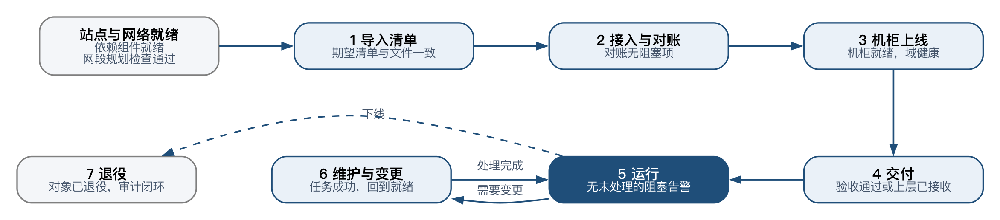

# Rack-level infrastructure management and provisioning platform: design specification

**English** · [简体中文](whole-rack-operations.zh-CN.md) · [Design documents](README.md)

The design of whole-rack operations for GB200 / GB300, built on NVIDIA Infra Controller (NICo).

- Status: design draft, for design review. This document describes the target design, not implemented functionality; the application code on this branch still has the first-version pages.
- The page-level design is in the [frontend design](frontend/README.md): every page can be clicked through and carries its feature points.
- The interface is in Simplified Chinese. Menu and page names are quoted in Chinese, with an English gloss in parentheses where they first appear. The figures are labelled in Chinese.

## 1. Purpose

This document gives the overall design of the rack-level infrastructure management and provisioning platform (PXEye): the platform architecture, the end-to-end operations workflow, what each module is for and which resources it owns, how modules interact and depend on each other, the design of operations, and the non-functional design. It is the common basis for interface design, work breakdown and acceptance testing.

Its chapters correspond one to one with the [requirements specification](../archive/rack-operations-v1/design/rack-operations-requirements.md): the requirements say which capabilities are wanted, and this document says how the platform organises them. The target hardware is the NVIDIA GB200 / GB300 NVL72 whole rack, and the foundation is NVIDIA Infra Controller (NICo).

## 2. Design goals

- NICo is the source of truth and the execution engine: once a device is written to NICo, its state is what NICo says. The platform adds the interface, the arrival inventory, the matching of devices to the inventory and the gating of operations, and does not rebuild what NICo already provides.
- The device is the base object, and the rack is a layer on top of devices. The address, state, firmware and single-device operations of a device are managed by device; the rack is the unit of operation only for what holds for a whole rack at once (bring-up, rack-wide power and firmware, rack maintenance). One NVL72 rack is one NVLink domain.
- Objects, states and operations mean what they mean in NICo: a rack offers only the operations NICo defines on the rack object; installing an operating system and instances exist only on a single machine. What the platform adds (device operations started for a whole rack, the inventory check, the rack elevation) is stated as such on the page.
- Device data has a single manual input: the arrival inventory, which gives the rack, slot, serial number and device credentials. MAC addresses, IP addresses and models come from discovery; site-level configuration is prepared once at deployment and checked item by item by the platform.
- An operation takes at most three inputs: object, action, reason. Order, timeouts and retries are decided by site-level rules and are not filled in per operation. The per-machine configuration used to install an operating system has defaults for every item, so by default it only has to be reviewed.
- Every write operation can be previewed, tracked and audited; an unknown result is never resent automatically.
- Critical safety interlocks stay with the facility. The platform does not replace them and only refuses an operation when it detects a risk.

## 3. Scope and boundaries

### 3.1 In scope

- Inventory, discovery and state management of racks, NVLink domains, compute trays, switch trays (NVLink switches) and power shelves; servers that do not belong to a rack are included as well.
- Enrolling racks and bringing them up; tracking the progress of rack maintenance, terminating it, and running it again after a failure; power on and off and firmware updates of racks and devices; maintenance, quarantine, replacement and decommissioning of devices; deleting a rack.
- Installing an operating system machine by machine with acceptance, and viewing and releasing instances.
- A health summary of racks, domains and trays, with entry points for handling alerts.
- Profiles such as firmware baselines and installation profiles, and the audit of every write operation.

### 3.2 Out of scope

- Closed-loop control on the facility side, such as circuit breakers and coolant valves; the building management system (BMS) owns it.
- Configuration of devices NICo does not manage, such as access switches and rack PDUs.
- Storing and displaying time series such as metric curves, power and temperature; the monitoring system owns them, and the platform only links to it.
- Cluster assembly and workload scheduling, such as Kubernetes and SLURM.
- Multi-tenancy: managing tenants, instance types and quotas, and creating NVLink logical partitions. The platform creates instances one machine at a time under the site's default tenant and does not hand machines out to other platforms.
- Adapting to non-standard networks; this does not enter the main flow. Servers that do not belong to a rack are covered by device management and installation, but adapting to their models is not described in this document.
- Deployments in which NICo manages the DPUs (DPU mode). In this version the BlueField cards of a compute tray are used as network cards only (network-card mode). The DPU page is kept and states what is supported; DPU mode is left to a later phase, and 6.3 describes how the two differ.
- Power and firmware operations at the level of an NVLink domain, and phased firmware rollout across racks.

## 4. Architecture

### 4.1 Layers and responsibilities

| Layer | Component | Main responsibility | Key objects |
| --- | --- | --- | --- |
| Operator interface | PXEye | Inventory import, reading device identity and matching it to the inventory, gating of operations, task tracking, audit, profiles | Arrival inventory, device credentials held temporarily, profiles, audit, installation tasks |
| Orchestration | NICo REST and Flow | Orders rack-level power and firmware operations in steps by operation rules and persists tasks; powers a rack off automatically on a rack-level leak | Tasks, operation rules |
| Facts and state | NICo Core | Device declarations, probing and ingestion, the state machines (rack bring-up is run by the rack state machine on its own), health, subnets and addresses, OS definitions and instances | Racks, domains, trays, NVLink partitions, instances |
| Hardware backend | RMS (Rack Management Service) | Carries out power, reset and firmware on trays, switches and power shelves | Hardware protocols and per-device ordering |
| Interconnect | NMX-C | Forms and partitions NVLink domains | NVLink domains, partitions |
| Boot | NICo DHCP, PXE, Scout | Address assignment, network boot, hardware discovery and preparation | Leases, boot artifacts |
| Facility | BMS, DSX Exchange | Leak events, breaker and coolant valve interlocks | Leak events |
| Observability | Prometheus, Grafana, Loki | Metrics, logs | Curves, logs |

### 4.2 Access paths

The platform reaches NICo through two paths, with one rule: an operation that must be ordered across several devices goes through a Flow task, and everything else goes to Core. The bring-up task of a new rack also goes through Flow; the rack maintenance that follows once the switches are ready is not submitted by the platform, and Core's rack state machine runs it on its own.

| Path | Used for | Why |
| --- | --- | --- |
| NICo REST and Flow | Bring-up of a new rack, power on and off and firmware of racks and trays, expected-versus-actual validation, querying and cancelling tasks | Flow orders the work by operation rules and persists the task; the platform does not orchestrate the order itself |
| NICo Core | All reads; device declarations; running rack maintenance again and terminating it; deleting a rack; maintenance marks, quarantine, validation and decommissioning of a single device; OS definitions and instances | Single-object operations, with no ordering problem |

One access does not go through NICo: after a device is powered on and has an address, the platform reads its BMC once with the credentials from the arrival inventory to get the device type, serial number and model, and uses them to match the inventory. Apart from that the platform does not access devices directly.

### 4.3 Dependencies

| Component | Role | Required |
| --- | --- | --- |
| NICo Core, REST, Flow | Foundation | Yes |
| RMS | Whole-rack hardware backend | Yes |
| NMX-C | NVLink domains | Yes |
| Temporal, PostgreSQL | Workflow engine and state storage | Yes |
| Vault, cert-manager, External Secrets, MetalLB | Credentials, certificates, service addresses | Yes |
| Rack validation service (RVS) | Validation before a rack becomes ready | As the NICo state machine requires |
| BMS and DSX Exchange | Facility-side leak events | Recommended for liquid-cooled sites |
| Prometheus, Grafana, Loki | Metrics and logs | Recommended |

The platform does not configure the internal parameters of these components. It does three things: installs them from a fixed list at deployment; checks on the site page whether they are ready; and when one is missing, shows the operations that depend on it as unavailable, with the reason.

## 5. Operations workflow

The workflow has two parts. The first is the onboarding of a new rack, from site preparation to delivery, in eight stages (P1–P8). The second is the running period that follows: running, maintenance and change, and decommissioning (P9–P11). Every stage has a unique identifier, a responsible party, an entry condition and an exit condition; a stage does not start until the exit condition of the stage before it is met.

Onboarding a new rack needs a person's confirmation at three points: enrollment, bring-up and delivery. The three are independent: enrollment only registers devices in NICo, bring-up makes the rack ready, and installing an operating system belongs to delivery and is done machine by machine.

The workflow in this chapter is about a whole rack. A server that does not belong to a rack goes through only P3 inventory import, P5 identification and matching, P6 enrollment and P8 delivery, and has no P7 bring-up: it is enrolled one server at a time, and NICo powers it on and ingests it at its first operating system installation; see P6 and P8 in 5.4.

### 5.1 Overview

| ID | Stage | Responsible | How it starts | Entry condition | Exit condition |
| --- | --- | --- | --- | --- | --- |
| P1 | Site preparation | Administrator | Once per site | The management cluster is available | Every dependency on the site page is ready, and rack profiles are configured |
| P2 | Network preparation | On-site staff, administrator | Once per batch of racks | P1 complete | The plan check passes |
| P3 | Inventory import | Operator | Once per batch of racks | P1 and P2 complete | The inventory is saved, the rack profile is derived, and the credentials are complete |
| P4 | Racking and cabling | On-site staff | Once per rack | P2 complete | The rack is connected to power, and the three kinds of management interface are on their subnets |
| P5 | Identification and matching | Platform, NICo | Automatic once the rack is connected to power | P3 and P4 complete | Every device in the inventory is matched, or the missing ones are confirmed |
| P6 | Enrollment | Operator | Manual confirmation | P5 complete | Every matched device is registered in NICo |
| P7 | Bring-up | Operator | Manual confirmation, then automatic | P6 complete | The rack state is Ready and the NVLink domain is formed |
| P8 | Delivery | Operator | Manual confirmation | P7 complete | Instances are ready and accepted |
| P9 | Running | Operator | Continuous | P8 complete | No unhandled critical alert |
| P10 | Maintenance and change | Operator | On demand | P7 complete | The task succeeds and the rack returns to Ready |
| P11 | Decommissioning | Operator | On demand | No instance on the device | The devices are decommissioned; a rack whose members are all decommissioned is deleted; the audit is closed |

P3 and P4 do not depend on each other and can run in parallel.

How rack states map to stages: no rack object in NICo yet corresponds to P3–P6; Discovering, Maintenance (with its current stage) and Validating correspond to P7; Ready corresponds to P8–P10; Error needs a person to remove the cause and run rack maintenance again. Pages show NICo's state verbatim, and the stages are used for navigation only.

### 5.2 Roles and responsibilities

| Role | Responsibilities | Stages |
| --- | --- | --- |
| On-site staff | Racking, cabling and connecting the rack to power; configuring subnets and DHCP relay on the management switches | P2, P4 |
| Administrator | Deploying the platform and its dependencies; site configuration; subnet planning | P1, P2 |
| Operator | Importing the inventory; handling unmatched devices; confirming enrollment, bring-up and delivery; operations in the running period | P3, P5–P11 |
| Platform | Validating and saving the inventory; reading device identity and matching it to the inventory; writing device declarations; submitting and tracking tasks; audit | P2–P11 |
| NICo | Address assignment; probing and ingesting devices; executing the bring-up task and rack maintenance; instances and boot | P5–P11 |

### 5.3 Devices and management interfaces

Every activity in the workflow acts on one interface of one kind of device. An NVL72 rack contains three kinds of device:

| Device | Management interface | Subnet | Purpose |
| --- | --- | --- | --- |
| Compute tray | BMC | Out-of-band management | Power control, reading hardware information, BIOS settings |
| Compute tray | Host interface | Host management | Network boot, operating system installation and system management of the host |
| Compute tray | BMC of a BlueField card | Out-of-band management | In this version a BlueField card works in network-card mode; NICo probes it and does not manage it |
| Switch | BMC | Out-of-band management | Power control, reading hardware information |
| Switch | NVOS management port | Switch system management | Configuring the switch system, certificates and NMX-C |
| Power shelf | PMC | Out-of-band management | Power control, reading state |

Below, BMC and PMC are together called the management controller. The number of devices of each kind is defined by the rack profile. Management switches and facility systems are not managed by NICo: on-site staff configure the subnets, gateways and DHCP relay of the former, and the latter provide power, liquid cooling and leak detection.

### 5.4 Onboarding a new rack

#### P1 Site preparation

- Purpose: make the platform and its dependencies available, and settle the site-level configuration.
- Responsible: administrator.
- Entry condition: the management cluster is available.
- Exit condition: every dependency on the site page is ready, and rack profiles are configured.

| ID | Activity | Performed by |
| --- | --- | --- |
| P1-1 | Deploy the platform, NICo Core, DHCP and the boot services | Administrator |
| P1-2 | Deploy the dependencies a whole rack needs; see 4.3 | Administrator |
| P1-3 | Configure rack profiles: the number of devices of each kind and the firmware list | Administrator |
| P1-4 | Configure site policy: BlueField cards work in network-card mode; storing switch NVOS credentials is enabled; the site credential used after ingestion is set | Administrator |

#### P2 Network preparation

- Purpose: provide usable subnets and addresses for the three kinds of management interface.
- Responsible: on-site staff, administrator.
- Entry condition: P1 complete.
- Exit condition: the plan check passes.

| ID | Activity | Performed by |
| --- | --- | --- |
| P2-1 | On the management switches, configure a VLAN and gateway for each of the three subnets: out-of-band management, switch system management, host management | On-site staff |
| P2-2 | Configure DHCP relay for each subnet, pointing at the service address of NICo DHCP | On-site staff |
| P2-3 | Create the three subnets and their DHCP pools in the platform | Administrator |
| P2-4 | Run the plan check: every purpose has a subnet, and the assignable addresses are no fewer than the interfaces of the racks in the inventory need | Platform |

P2-1 and P2-2 come before P2-3: the platform only creates subnets in NICo and does not configure switches.

#### P3 Inventory import

- Purpose: establish the basis on which devices enter NICo.
- Responsible: operator.
- Entry condition: P1 and P2 complete.
- Exit condition: the inventory is saved, the rack profile is derived, and the credentials are complete.

| ID | Activity | Performed by |
| --- | --- | --- |
| P3-1 | Prepare the arrival inventory: one row per device, with rack, slot, device type and serial number | Operator |
| P3-2 | Provide device credentials: user name and password of the BMC; a switch also needs the user name and password of NVOS. Defaults can be given per batch | Operator |
| P3-3 | Import the inventory and choose the rack topology and manufacturer; the platform derives the rack profile and validates | Operator, platform |
| P3-4 | Confirm the difference and save. The rows are “待匹配” (waiting to be matched) | Operator, platform |

The arrival inventory contains no MAC or IP addresses. Nothing is written to NICo in this stage.

#### P4 Racking and cabling

- Purpose: complete the physical installation of the rack and put its management interfaces on their subnets.
- Responsible: on-site staff.
- Entry condition: P2 complete.
- Exit condition: the rack is connected to power, and the three kinds of management interface are on their subnets.

| ID | Activity | Performed by |
| --- | --- | --- |
| P4-1 | Position the rack and connect power and liquid cooling | On-site staff |
| P4-2 | Connect the management cables: BMCs and PMCs to the out-of-band management subnet, NVOS management ports to the switch system management subnet, host interfaces to the host management subnet | On-site staff |
| P4-3 | Check the hardware against the arrival inventory: rack identifier, slots, serial numbers | On-site staff |
| P4-4 | Connect the rack to power | On-site staff |

This stage follows the installation procedures of the device manufacturers; the platform takes no part in it.

#### P5 Identification and matching

- Purpose: determine which row of the arrival inventory each powered device corresponds to.
- Responsible: the platform and NICo, automatically; the operator handles unmatched devices.
- Entry condition: P3 and P4 complete.
- Exit condition: every device in the inventory is matched, or the missing ones are confirmed.
- Constraint: devices are only read; nothing is written to NICo and no device is changed.

| ID | Activity | Performed by | Compute tray | Switch | Power shelf |
| --- | --- | --- | --- | --- | --- |
| P5-1 | Management controllers request addresses | NICo | The BMC gets an address from the out-of-band pool | The BMC gets an address from the out-of-band pool | The PMC gets an address from the out-of-band pool |
| P5-2 | Read the device identity | Platform | Device type, serial number, model | Device type, serial number, model, MAC addresses of the NVOS management ports | Device type, serial number |
| P5-3 | Match the inventory | Platform | Find the row by serial number, which gives the rack and slot | Same | Same |
| P5-4 | Handle unmatched devices | Operator | On an authentication failure, give credentials and retry; when the serial number is not in the inventory, replace a row or add the device | Same | Same |

The BMC of a BlueField card also gets an out-of-band address in this stage, but it is not identified separately and is handled with its compute tray. Reading the identity uses the credentials in the inventory or the batch defaults, and never tries other passwords after a failure.

#### P6 Enrollment

- Purpose: register the matched devices in NICo, so that NICo takes over their out-of-band management.
- Responsible: the operator confirms; the platform and NICo carry it out.
- Entry condition: P5 complete, and the operator has checked the matching result.
- Exit condition: every matched device is registered in NICo.
- Constraint: no power-on, no BIOS change, no disk access, no firmware update, no operating system installation; the addresses of the management controllers do not change.

| ID | Activity | Performed by | Compute tray | Switch | Power shelf |
| --- | --- | --- | --- | --- | --- |
| P6-1 | Confirm enrollment. The devices in a rack are confirmed once per rack | Operator | — | — | — |
| P6-2 | Write the rack-level declarations: rack group, rack, NVLink domain | Platform | — | — | — |
| P6-3 | Write the device declarations | Platform | MAC of the BMC, credentials, rack, slot; with the pause flag; BlueField in network-card mode | MAC of the BMC, MAC addresses of the NVOS management ports (the primary one marked), credentials of the BMC and of NVOS, rack | MAC of the PMC, credentials, rack |
| P6-4 | Log in to the management controller and change its password | NICo | The BMC password becomes the site credential | The BMC password becomes the site credential | The PMC password becomes the site credential |
| P6-5 | Create the device object | NICo | Not created: the pause flag keeps NICo from powering on or ingesting it | Created, waiting for the NVOS management port to come up | Created and Ready |

A device matched after the rack has been enrolled goes through P6-3 to P6-5 automatically.

Enrollment applies to devices: in NICo each device has its own declaration, and the rack itself has only the rack-level declarations of P6-2. The 确认纳管 (Confirm enrollment) the page offers on a rack starts enrollment for all matched devices of that rack at once. A server that does not belong to a rack is enrolled one server at a time on the device discovery page, with the activities of the compute tray column in P6-3 to P6-5 and no rack in its declaration; it has no P7, and NICo powers it on and ingests it at its first installation in P8.

#### P7 Bring-up

- Purpose: make the rack ready.
- Responsible: the operator confirms; NICo executes the bring-up task, device ingestion and rack maintenance.
- Entry condition: P6 complete.
- Exit condition: the rack state is Ready, all three kinds of device are Ready, and the NVLink domain is formed.
- Constraint: no operating system installation, no instance creation.

The bring-up task, submitted by the operator and executed in order:

| ID | Activity | Performed by | Compute tray | Switch | Power shelf |
| --- | --- | --- | --- | --- | --- |
| P7-1 | Start bring-up and submit the bring-up task | Operator | — | — | — |
| P7-2 | Power on the power shelves | NICo | — | — | Powered on, and the power state confirmed |
| P7-3 | Power on the compute trays and release them for ingestion | NICo | Powered on; the pause flag removed | — | — |
| P7-4 | Compute tray firmware | NICo | Updated when the version differs from the expected one | — | — |
| P7-5 | Power on the switches | NICo | — | Powered on, and the power state confirmed | — |
| P7-6 | Check switch firmware | NICo | — | Version consistency checked, not updated | — |
| P7-7 | Restart the compute trays | NICo | Restarted so that the firmware takes effect | — | — |

Device ingestion, done by NICo on its own after a device is powered on or released:

| ID | Activity | Performed by | Compute tray | Switch | Power shelf |
| --- | --- | --- | --- | --- | --- |
| P7-8 | Ingest the device | NICo | Correct the BMC clock; set BIOS and boot order; boot the discovery program from the host management subnet, which assigns the host management address; report the hardware inventory; validate the hardware; lock the BIOS; read the observed slot. All disks may be cleaned, depending on site policy | Associate the NVOS management port; configure the certificate; change the NVOS password and store it in the credential store; read the observed slot; validate | Already Ready since P6 |

Rack maintenance, done by NICo on its own once the number of ready switches reaches what the rack profile requires:

| ID | Activity | Performed by | Compute tray | Switch | Power shelf |
| --- | --- | --- | --- | --- | --- |
| P7-9 | Firmware upgrade | NICo | Updated from the rack profile's firmware list; skipped when no list is configured | Same | Same |
| P7-10 | NVOS update | NICo | — | The switch system is updated; skipped when no firmware list is configured | — |
| P7-11 | Power sequence | NICo | Powered on again in order when required | Same | Same |
| P7-12 | NMX-C cluster configuration | NICo | — | Switch certificates, Fabric Manager and the primary switch certificate are configured; the NVLink domain is formed when this completes | — |
| P7-13 | Rack validation | NICo | Runs when the site has enabled rack validation | Same | Same |

Rack maintenance has one start condition: the number of ready switches is not less than the switch count in the rack profile. A missing compute tray or power shelf does not affect rack maintenance and only raises an alert that the rack has fewer members than its profile. Rack maintenance has no manual confirmation switch and its order cannot be changed. While it runs, the operator can terminate it; the rack then enters Error and rack maintenance has to be run again.

#### P8 Delivery

- Purpose: install an operating system on ready servers so that they become usable compute resources.
- Responsible: the operator confirms; the platform and NICo carry it out.
- Entry condition: for a compute tray in a rack, P7 complete; for a server that does not belong to a rack, P6 complete.
- Exit condition: instances are ready and accepted.
- Scope: servers only, that is, compute trays in a rack and servers that do not belong to a rack. Switches and power shelves have no activity in this stage.
- Constraint: installation is per machine, one instance per machine. A rack is not the object of installation, only a filter when choosing devices.

| ID | Activity | Performed by |
| --- | --- | --- |
| P8-1 | Choose devices: filter by rack, choose across racks, or choose servers that do not belong to a rack | Operator |
| P8-2 | Review the configuration each machine will use: host name, installation profile, system disk, management address and boot interface. It comes from the system configuration in device management, with defaults for what was not filled in; change a machine when needed. This step runs no check | Operator |
| P8-3 | Installation-condition check: the platform checks device identity, installation configuration and operating system materials on each machine, and the operator confirms once everything passes | Platform, operator |
| P8-4 | NICo powers on and ingests a server that has not been ingested yet (only a server outside a rack, at its first installation) | NICo |
| P8-5 | Create one instance per machine; the instance name is the host name | Platform, NICo |
| P8-6 | The server boots the installer from the network and writes the operating system to the system disk | NICo, platform |
| P8-7 | Acceptance: check the host name, system disk and network, and verify with a restart | Platform |

The host name is also the instance name, and after installation it is the host name inside the system; NICo does not assign it, and when it was not filled in the platform generates it from the management address. The management address is matched to the MAC of the boot interface when devices are planned, and this stage only reviews it. All instances are created under the site's default tenant, and the pages do not show a tenant.

### 5.5 Device state and impact on devices

The state of the three kinds of device at the end of each stage:

| At the end of | Compute tray | Switch | Power shelf |
| --- | --- | --- | --- |
| P4 Racking and cabling | BMC powered, host off | BMC powered | PMC powered |
| P5 Identification and matching | Matched, not registered | Matched, not registered | Matched, not registered |
| P6 Enrollment | Enrolled, not powered on, no device object in NICo | Enrolled, the device object waits for the NVOS management port | Ready |
| P7 Bring-up | Ready, can be allocated | Ready | Ready |
| P8 Delivery | Each chosen compute tray has one instance, operating system installed | Unchanged | Unchanged |

The impact of each stage on devices:

| Stage | Power | Management password | BIOS | Disks | Firmware | Addresses |
| --- | --- | --- | --- | --- | --- | --- |
| P4 Racking and cabling | Only the management controllers are powered | Unchanged | Unchanged | Unchanged | Unchanged | — |
| P5 Identification and matching | Unchanged | Unchanged | Unchanged | Unchanged | Unchanged | The addresses of the management controllers are decided and do not change afterwards |
| P6 Enrollment | Unchanged | BMC and PMC passwords become the site credential | Unchanged | Unchanged | Unchanged | Unchanged |
| P7 Bring-up | Powered on and restarted | The NVOS password is changed | The BIOS of compute trays is changed and locked | All disks may be cleaned, depending on site policy | Updated when it differs from the expected version | The host management address is decided |
| P8 Delivery | Restarted | Unchanged | Unchanged | The system disk is written | Unchanged | Unchanged |

The observed slot is read by NICo from the hardware backend after it ingests a device in P7-8; compute trays and switches have one, power shelves do not. The slot in the inventory is therefore checked against the observed slot after P7; before P6 the only thing that can be checked is whether the devices in the inventory have appeared.

### 5.6 Manual confirmation points

| Confirmation | Stage | What the platform shows before confirmation | Activities that follow automatically | Undo |
| --- | --- | --- | --- | --- |
| Confirm enrollment | P6 | The number matched, the differences found by the inventory check, the unmatched devices still to handle, what will and will not be done | P6-2 to P6-5 | The management passwords have been changed and are not restored automatically; returning devices means decommissioning them one by one |
| Start bring-up | P7 | The number enrolled, whether the switches are all there, the steps of the bring-up task, the impact on devices | P7-2 to P7-13 | The bring-up task can be cancelled, but hardware actions already done are not undone; rack maintenance can be terminated, and the rack then enters Error |
| Confirm installation | P8 | The chosen devices and the configuration each will use (host name, installation profile, system disk, management address); the result of the installation-condition check; the devices that have to be ingested first and their disk-cleaning scope | P8-4 to P8-7 | After the instance is deleted, the device is cleaned and validated again and can then be installed again |

### 5.7 Running period

| ID | Stage | Main activities | Completion condition |
| --- | --- | --- | --- |
| P9 | Running | Watch the health and alerts of racks, NVLink domains and devices; handle the items marked as needing attention | No unhandled critical alert |
| P10 | Maintenance and change | Power, firmware update, maintenance mark, quarantine, tray replacement; the platform checks the impact and tracks the task | The task succeeds and the rack returns to Ready |
| P11 | Decommissioning | Devices are decommissioned one by one: confirm there is no instance, decommission, and remove from the inventory. When all members of a rack are decommissioned, delete the rack | The devices are decommissioned; the rack object is deleted; the audit is closed |

Chapter 9 gives the inputs and completion conditions of the operations in the running period.

### 5.8 Exception handling

| Stage | Exception | Handling |
| --- | --- | --- |
| P2 | The plan check fails | Create the missing subnet, or enlarge the DHCP pool |
| P3 | The derived rack profile is not configured | The administrator configures the profile in site settings, then the inventory is imported again |
| P3 | A row has no credentials | Add them to the row, or provide batch default credentials |
| P5 | A device gets no address | Check that the device has power, that its management cable is on the right subnet, and that DHCP relay works for that subnet |
| P5 | Authentication fails | Give credentials for that device and retry |
| P5 | The serial number is not in the inventory | For a factory replacement part, replace a row of the inventory; for an omission, add the device to the inventory |
| P6 | Some devices fail to be written | The reason is shown per device and the write can be retried; devices already written are not rolled back |
| P7 | The bring-up task fails at a step | The task stops at that step and hardware actions already done are not undone; submit it again after removing the cause |
| P7 | Switches are missing | Rack maintenance does not start. Add the switches; when the rack must be brought up with fewer, the administrator adjusts the switch count in the rack profile |
| P7 | Rack maintenance fails at a stage | The rack stops in Error and does not recover by itself; run rack maintenance again after removing the cause |
| P7 | Running rack maintenance has to be stopped | Terminate rack maintenance; the rack enters Error; run it again after removing the cause |
| P8 | A host name is not valid, or is the name of an existing instance | Shown per machine before submission; the review step opens only after it is corrected |
| P8 | The installation-condition check does not pass | Each failing item is listed with its device and reason; change the configuration or remove the cause, check again, and submit only after it passes |
| P8 | Installation or acceptance fails | Handled as a failed installation task; see 6.4 |
| P9 | Rack-level leak | NICo forces the whole rack off on its own and refuses power-on; after the facility side has handled it and the alert has cleared, the operator submits power-on |

### 5.9 Design premises and open item

The workflow rests on the premises below. When a premise does not hold, the stages listed for it have to be adjusted.

| ID | Premise | Stages affected |
| --- | --- | --- |
| A1 | After the rack is connected to power only the management controllers are powered; the main power of devices stays off until the bring-up task powers them on | P6, P7 |
| A2 | A management controller can be read with the credentials from the arrival inventory to get the device type, serial number and model | P5 |
| A3 | The BMC of a switch can report the MAC addresses of its NVOS management ports | P5, P6 |
| A4 | Management controllers use addresses assigned dynamically from the out-of-band pool, which do not change once assigned | P5, P6 |
| A5 | BlueField cards work in network-card mode, and the host gets its address from the host management subnet | P2, P7, P8 |

Open item: how the bring-up task and rack maintenance interleave when they run at the same time.

## 6. Module design

The platform has seven modules by responsibility. Every resource has a single place where it is maintained; other modules only refer to it.

| Module | Purpose | Resources it owns | Requirement chapters |
| --- | --- | --- | --- |
| Site | Whether the platform itself is usable | Site connection, component readiness | 6.6 |
| Network | Which subnet each kind of device interface uses, and whether DHCP is working | Nothing local; subnets, pools and address assignments are in NICo | 6.6 |
| Inventory | The arrival inventory and how it corresponds to NICo's device declarations | Inventory versions, rows waiting to be matched, device credentials held temporarily | 6.1, 6.2 |
| Racks and devices | The state and single-device operations of devices; the full lifecycle of racks and NVLink domains | Nothing local; everything is in NICo | 6.1, 6.2, 6.3, 6.4, 6.10 |
| Delivery | Install an operating system on ready servers, machine by machine, and manage instances | Installation tasks and acceptance records | 6.5, 6.9 |
| Health | What is wrong now, whom it affects, where to handle it | Nothing local | 6.7 |
| Profiles and audit | Reusable choices, and who did what | Firmware baselines, installation profiles, operation audit | 6.4, 6.8 |

### 6.0 Navigation

Modules describe responsibilities; the menu describes entry points. The menu goes straight to objects. The device is the base object: an operator who wants the address or firmware of a switch, or wants to power it, enters that device type from the menu without first finding which rack it is in. The rack is a layer on top of devices: the rack page holds only what NICo defines on the rack object (state, bring-up, rack-wide power and firmware, rack maintenance, deletion) and a summary of the member devices; the information and operations of a member device are on the device page, and a device's rack and position lead back to the rack. Installing an operating system is per machine, and its entry point is 安装任务 (Installation tasks), not the rack.

| Menu group | Menu item | Submenu | Module |
| --- | --- | --- | --- |
| 运维 (Operations) | 机柜管理 (Racks) | — | Racks and devices |
| 运维 | NVLink 域管理 (NVLink domains) | — | Racks and devices |
| 运维 | 设备管理 (Devices) | 服务器 (Servers), 交换机 (Switches), 供电框 (Power shelves), DPU | Racks and devices |
| 运维 | 健康告警 (Health alerts) | — | Health |
| 运维 | 运维任务 (Operation tasks) | — | Racks and devices |
| 运维 | 操作审计 (Operation audit) | — | Profiles and audit |
| 交付 (Delivery) | 安装任务 (Installation tasks), 实例管理 (Instances) | — | Delivery |
| 接入 (Onboarding) | 网络规划 (Network planning) | — | Network |
| 接入 | 设备清单 (Device inventory) | — | Inventory |
| 接入 | 设备发现 (Device discovery) | — | Racks and devices |
| 配置 (Configuration) | 站点设置 (Site settings) | — | Site |
| 配置 | 固件基线 (Firmware baselines), 安装方案 (Installation profiles) | — | Profiles and audit |

The three onboarding items are in the order they are used: plan the subnets, import the device inventory, then watch device discovery after power-on.

The menu has four groups, and only 设备管理 has a submenu, which can be collapsed. Menu names are formal four-character names, and page titles equal the menu names. A number on a menu item is always the count that needs attention. In the interface the three device types are collectively “设备” (devices): 服务器 (servers), 交换机 (switches) and 供电框 (power shelves). A server need not belong to a rack; a server in a rack is called a “计算托盘” (compute tray).

Interface text is Chinese throughout and does not join an English abbreviation with Chinese into one term: 安装方案, 交换机, 机柜上线, 就绪, 序列号, 开机 and 关机. Only product and component names (such as NICo, NVLink, RMS, BMC, DPU) and the state values reported by NICo state machines stay in their original form.

### 6.1 Site

- Shows whether NICo Core, Flow, RMS, NMX-C, the workflow engine and storage are ready.
- Rack profiles: how many compute trays, switches and power shelves each profile has, and which firmware list it uses. A rack profile is NICo site configuration, and NICo has no interface to change it; an administrator adjusts it here, and the platform updates NICo's site configuration and restarts NICo in a rolling way. The switch count is the minimum threshold for rack maintenance to start.
- Subnets, DHCP and boot service addresses are not maintained here; see 6.7 Network.
- Automation guide: some things the system does on its own, and the operator does not see them happen. One table says, per scenario, when it starts, what the system does on its own and what a person has to do, covering connecting a rack to power, new rack bring-up, power on, power off and restart, firmware update and a rack-level leak. Read-only.
- When firmware is updated: on two occasions only, new rack bring-up (when the rack profile has a firmware list) and a firmware update submitted by a person. Otherwise nothing is updated automatically; a device whose version differs from the baseline is only marked.
- When a component is not ready, the operations that depend on it are shown as unavailable across the platform, with the reason.

### 6.2 Inventory

- The arrival inventory is the only manual input of device data. It comes from DCIM or the shipping list: one table, one row per device, covering all three tray types.
- The inventory gives the device type, serial number and device credentials, and for a device in a rack also the rack and slot. It does not require MAC or IP addresses: a shipping list usually has no MAC addresses, and the MAC is obtained from DHCP after the device is powered on.
- A server that does not belong to a rack is in the inventory too, with the rack and slot left empty. It is matched the same way, and it is enrolled one server at a time on the device discovery page. Switches and power shelves must belong to a rack.
- A row has three states. After import it is “待匹配” (waiting to be matched) and is held by the platform only, because NICo keys a device declaration by the MAC of the BMC. When the device is powered on and the platform reads a serial number that matches the row, it is “已匹配” (matched); nothing is written to NICo yet. After enrollment is confirmed (once per rack for the devices in a rack, one server at a time for a server outside a rack), the declaration is written to NICo with the MAC, credentials, rack and slot, and the row becomes “已纳管” (enrolled). Enrollment only registers the device: it is not powered on and no operating system is installed.
- An import is a whole-table difference: it shows what is added, changed and removed, and saves after confirmation. Removing a device that has an instance or a task in progress is refused.
- The rack profile is derived from the rack topology and rack manufacturer chosen at import. The rack topology is NICo's name for a rack hardware layout (for example gb200_nvl72r1_c2g4); the choices are read from the rack profiles NICo has configured, and the platform does not maintain that list. The import preview reports an error when NICo has not configured the derived profile.
- Device credentials: a device uses the values in its own row, or the batch defaults entered at import when the row leaves them empty. A switch needs NVOS credentials as well as BMC credentials. A password is submitted once and held encrypted; it never appears on a page, in a version record or in the audit. After the declaration is written to NICo the credentials are NICo's, and the platform no longer keeps them.
- Inventory files are versioned, and the password columns are removed before a file is kept.

Columns of the arrival inventory:

| Column | Meaning | Required |
| --- | --- | --- |
| rack | Rack ID, using the DCIM identifier | Required for a device in a rack |
| slot | Slot in the rack | Required for a device in a rack |
| type | compute, switch, power_shelf | Yes |
| serial | Device serial number, the only thing a device is matched by | Yes |
| location | Physical location of the rack | No |
| management_ip | Planned management address of a server, for servers only; matched to the MAC of the boot interface once the device is discovered | No |
| bmc_user, bmc_password | User name and password of the device BMC; the batch default is used when empty | No |
| nvos_user, nvos_password | User name and password of the switch NVOS; the batch default is used when empty | No |

The import also asks for the rack topology and rack manufacturer (together they decide the rack profile) and for the batch default credentials.

### 6.3 Racks and devices

The device is the base object, and the rack is a layer on top of devices. The same objects can be entered in two ways: through the device to operate it directly, or through the rack to see the rack as a whole. Three rules divide the work:

- The address, state, firmware and single-device operations of a device are maintained on the device page only; the rack page refers to them and summarises, and links to the device page.
- The rack page offers only the operations NICo defines on the rack object, with the state, health and profile of the rack.
- What the platform adds is stated as such on the page: device enrollment started for a whole rack, the inventory check, the rack elevation.

| View | Question it answers | Content |
| --- | --- | --- |
| Racks | Which step of the flow each rack is in, and which members it has | The rack list; the rack detail has enrollment confirmation, starting bring-up, rack maintenance progress, the inventory check, the rack elevation, tasks, health and history, and the rack-level operations |
| NVLink domains | Whether a domain is formed, and which partitions it has | For each domain: whether NMX-C is reachable, the domain health, the number of switches whose Fabric Manager is healthy, and the NVLink partitions. Read-only |
| Devices | How the device I am looking for is doing | Search across types (serial number, address, MAC, instance); the devices that need attention |
| Servers, switches, power shelves | The addresses, state and firmware of one device type, and which ones have problems | One list per type, with addresses and firmware versions in the table; power and other operations from the row, with batch support. The server page lists both the compute trays in racks and the servers that do not belong to a rack |
| DPU | How each BlueField card is operating, and whether that matches the policy | A read-only list: serial number, owning compute tray, BMC address, policy, observed operating mode, NIC firmware; it states that this version supports network-card mode only |
| Device discovery | How far the devices in the inventory have got, and which ones do not match | The endpoints waiting to be handled, with a way to handle each; the progress of every row of the inventory |
| Tasks | How far rack-level power and firmware operations have got | The steps and results of all Flow tasks |

- The default home page is the rack list. It contains every rack in the inventory; a rack that has no object in NICo yet is shown as “尚未建立” (not created yet). Rack objects are not created by hand: NICo creates one when the first member device is ingested.
- One NVL72 rack is one NVLink domain, so there are no domain-level power or firmware operations. A domain has two identifiers: the rack group ID from the inventory, and the domain ID reported by NMX-C after rack bring-up. The page shows both. Neither domains nor partitions are maintained on this page: a domain is declared automatically from the racks in the arrival inventory; logical partitions are not created in the platform in this version, and the ones that exist in NICo are shown here read-only; the matching NMX partition is created by NICo when the first instance joins.
- Identification and matching, enrollment and bring-up of a new rack follow the stage definitions in 5.4; 5.5 gives the impact of each stage on devices and 5.6 the manual confirmation points. Where they appear on the pages: unmatched devices are handled in “设备发现” (device discovery); enrollment confirmation and starting bring-up are in the rack detail, each as a card that lists in two columns what will and will not be done; the progress of the bring-up task is on the task tab of the rack detail, and the progress of rack maintenance is shown separately at the top of the rack detail.
- Inventory check: two kinds of difference. One is a row of the inventory whose serial number no device has reported yet; the other is a device whose observed slot differs from the slot in the inventory. The observed slot is what NICo gets from the hardware backend RMS after ingesting the device, and RMS reads it from the tray's BMC; compute trays and switches have one, power shelves do not, and it exists only after bring-up. The check helps a person see the situation and does not hold bring-up back: rack maintenance does not start while switches are missing, and a missing compute tray or power shelf, or a slot difference, does not affect it. The switch count is the minimum threshold for rack maintenance to start and is written in the rack profile; bringing a rack up with fewer switches requires an administrator to adjust that count in site settings.
- Rack-level operations: starting bring-up, power on, power off, restart, firmware update, expected-versus-actual validation, terminating rack maintenance while it runs and running it again when the rack has stopped in Error, and deleting the rack. These are all the write operations NICo defines on the rack object. A rack has no operation that installs an operating system or creates instances. A rack object has no power state, so the page shows how many of its members are powered on.
- Enrollment confirmation: enrollment registers devices one by one. The 确认纳管 (Confirm enrollment) on the rack detail starts it for all matched devices of the rack at once, and writes the rack-level declarations of that rack.
- Deleting a rack: it deletes the rack object only and does not handle the member devices. The preconditions are that the rack has no instance, every member device has been decommissioned, and no task is in progress; the page shows whether each one holds, and the deletion cannot be submitted until all of them do.
- Device-level operations: power on, shut down, restart, firmware update, maintenance mark, quarantine, on-demand hardware validation, BMC restart, replacement, decommissioning. The available actions differ by type, and all of them use the same operation dialog. Decommissioning is a per-device operation, and all three device types have it.
- System configuration: the configuration a server uses at its next installation. Only three items can be changed, namely host name, installation profile and system disk, and each has a default: the host name is generated from the management address, the installation profile is the default of the architecture, and the system disk follows the disk rule of the profile. The management interface (boot interface and management address) is matched when devices are planned and is shown here without being editable; the other interfaces are not managed by the platform and are not shown. The system configuration is maintained on the device page, and an installation task only refers to it.
- A server that does not belong to a rack appears on the device pages only, with “未分配机柜” (no rack assigned) as its rack and position. It has no bring-up: it is enrolled one server at a time on the device discovery page, is not powered on after enrollment, and NICo powers it on and ingests it at its first operating system installation.
- Device running state: running state, health alerts, firmware compared with the baseline, state timeline. A compute tray also has its instance, DPUs, hardware capabilities and LLDP neighbours; a switch also has NVOS management ports and Fabric Manager. A power shelf has no readable firmware version or power figures, so only its address, state, health and power are shown.
- The two ways to use a DPU. NICo has a DPU policy per host, with a site default that a host's declaration can override. In network-card mode a BlueField card is an ordinary network card: NICo only probes it, the host gets its address from the host management subnet, and delivery uses a network that does not pass through the DPU. In DPU mode each card is a device NICo manages, with its own system and firmware, and the host's address and tenant networks are provided through it. In this version every policy the platform writes is network-card mode, and onboarding, network planning and delivery are designed for it. When DPU mode is supported later, the policy becomes a column of the inventory, the DPU page adds each card's running state and its pairing with the host, network planning adds the subnets for the DPUs themselves and for hosts behind DPUs, and delivery uses a network that passes through the DPU.
- Open: how the bring-up task and NICo's automatic rack maintenance interleave when they run at the same time. It will be decided after measurement.

### 6.4 Delivery

- What is delivered is a server, one machine at a time: one instance per machine. A rack is not the object of delivery, only a filter when choosing devices; devices can be chosen across racks, and servers that do not belong to a rack can be chosen too.
- The entry point is 新建安装任务 (New installation task) on 安装任务 (Installation tasks). The entries of the same name on the rack detail, the server list and device discovery open the same wizard with the devices already chosen.
- The wizard has three steps: choose devices, review the configuration, check and confirm. Choosing devices and the installation-condition check are taken from the installation wizard of the existing product, pages and check items included. A batch has at most 50 machines.
- Reviewing the configuration only reviews; it runs no check. It is a list, one row per machine, with the host name, installation profile, management address and boot interface, and system disk; these come from the system configuration in device management (see 6.3), every item has a default, and an item that comes from a default is marked as default. By default the operator fills in nothing and moves on after reading the list. To change a machine, click it to open its system configuration; saving returns to the list.
- The host name is also the instance name, and after installation it is the host name inside the system. When it was not filled in it is generated from the management address, for example node-198-51-100-78 for 198.51.100.78; before submission the platform checks its form and that it repeats no other name.
- The network is only reviewed: the list shows the management interface alone, that is the management address and the boot interface, which are matched when devices are planned and are not changed here. The platform does not manage the other interfaces.
- A machine can be installed when it is ready, has no instance, has no quarantine or maintenance mark, and has no alert that prevents allocation; a device in a rack also needs the rack to be Ready, with no rack-level leak and no task in progress. The reason a machine cannot be installed is shown per machine in the 安装条件 (installation condition) column, a problem on one device does not affect the others in its rack, and the platform offers no bypass.
- While choosing devices the operator can query the 当前系统 (current system) on demand. The query is read-only and confirms what is on a device before its system disk is overwritten.
- The installation-condition check is a third step of its own, because it logs in to the BMC of every machine and checks address occupancy and the installation materials, which takes time; placed after the review, it is not triggered again and again while configuration is being changed. It runs per machine in three groups. Device identity: BMC authentication and serial number. Installation configuration: the machine is ready and has no instance, the host name and installation profile, the management address and its occupancy, the system disk. Operating system materials: the installation materials can be fetched and their length equals what is registered. If any item fails on any machine the batch cannot be submitted; each failing item is listed with its device, the check name and the reason.
- The system disk is resolved by the disk rule of the installation profile and must resolve to exactly one disk. When it does not, the review list already marks it, and the check opens only after a disk is set in the system configuration of that machine.
- Installation profiles are matched by the architecture of the device, published ones only, and the default profile of the architecture is used when none was chosen; the system disk follows the rule of the installation profile by default and can be set for a machine in its system configuration.
- When the configuration has not changed, returning from the review to the third step reuses the last check result instead of checking again; the check can be run again by hand. A passed check only says the batch could run at that time: on submission the server checks the configuration and occupancy again, and a full digest check of the installation materials is done before execution.
- A server outside a rack that is enrolled but not yet ingested can be installed too: the first step of the installation task has NICo power it on and ingest it, and only then is the system disk written. Its machine readiness and system disk are settled before execution and do not count as failed checks; the first ingestion cleans all disks, non-system disks included, and that needs a separate confirmation.
- Installation uses NICo's DHCP, PXE and templated OS. One submission is one batch, and the installation process and the acceptance result are kept per machine.
- All instances are created under the site's default tenant, and the pages do not show a tenant; the platform does not hand machines out to other platforms.
- Release goes through NICo's cleaning and re-validation; a machine cannot be installed again until cleaning has finished.

### 6.5 Health

- Summarises the current health alerts of racks and the three tray types, grouped by alert or by object, and marks two classes: prevents allocation, and rack-level leak. Alert identifiers and classes are NICo's own.
- “需要处理” (needs attention) uses NICo's signals only: the state machine failed to process, or there is a health alert.
- When no report has been received the page shows “未报告” (not reported), never healthy.
- “阻止分配” (prevents allocation) affects only the host it is on: that host is not allocated to a new instance. A host with a maintenance mark is in this class too. It does not mean the rack has a problem.
- Leaks have two levels. A tray-level leak is reported by the device's sensor. On a rack-level leak NICo forces every device of the rack off on its own and refuses to power it on again; the devices do not power on by themselves after the alert clears. The page shows this automatic power-off and the affected instances as they are. The site page says so when facility-side events are not connected.
- When a rack has fewer members than its profile there is a rack-level alert that counts by device type, names no slot, and does not prevent allocation.
- Curves, power and temperature link to the monitoring system; the pages do not rebuild them.

### 6.6 Profiles and audit

- Firmware baseline: a set of versions bound to a rack profile, corresponding to the firmware list the site configures for that profile. A firmware update can only choose a baseline, never an arbitrary version. NICo can only tell whether a device's version equals the baseline, not which is newer; NVOS and power shelves have no readable installed version. A firmware update skips devices whose version already equals the chosen baseline.
- Installation profile: reusable system, disk and login defaults, distinguished by architecture. An installation task can only choose a published profile whose architecture matches the device; what differs per machine is not written in a profile.
- Audit: every write operation records the operator, object, action, reason, task number and the state read back. Records are append-only and never deleted.
- Roles: read-only cannot run operations; operator can run device, rack and installation operations; administrator can also change the site, the network and installation profiles. Once the site's identity system is connected, the audit records a person.

### 6.7 Network

Subnets must be planned before the device inventory is imported. A device is discovered only after it gets an address according to the plan when it is powered on.

Device interfaces fall into three purposes, and each purpose has at least one subnet:

| Purpose | Device interfaces | NICo network type | Notes |
| --- | --- | --- | --- |
| Out-of-band management | Compute tray BMC, switch BMC, power shelf PMC, DPU BMC | Underlay | The entry point of device discovery: once these interfaces have an address, the platform reads the device identity |
| Switch system management | Switch NVOS management port | Underlay | Configuration and management of a switch after ingestion |
| Host management | Compute tray host interface | HostInband | Network boot, installation and system management of the host |

- Plan check: every purpose has a subnet, and the assignable addresses are no fewer than needed. The need is counted by interface, not by device: one BMC per device, two more NVOS management ports per switch, and one for the BMC of each DPU. The device inventory cannot be imported while the check fails; the import preview counts the new racks in.
- Subnet: name, purpose, prefix, gateway, DHCP pool, assigned and assignable. Only the DHCP pool of an existing subnet can be changed. The purpose and the switch-side VLAN are recorded by the platform; a NICo subnet has neither. The DNS domain of a subnet is filled in by the platform with the site's default domain; it is neither chosen nor shown, except that a new host management subnet asks for one when the site has several DNS domains.
- DHCP service: a whole-rack site uses NICo DHCP only. For each subnet the page shows when an address was last handed out and how much of the pool is used, and marks a subnet that has never handed one out. The boot service addresses (network boot, installation material, DNS, NTP) are maintained here.
- When addresses are decided: a BMC address is assigned from the pool when the rack is connected to power, and neither enrollment nor bring-up changes it; the host management address is assigned when a compute tray is brought up and first boots from the network. Giving a BMC a planned fixed address is not in this version: it requires a declaration with the address before the device first requests one, and the arrival inventory has no MAC addresses.
- Address assignment: which interface of which device each address was given to, and the allocation type NICo reports (dynamic, fixed, reserved). The allocation type is decided per device; it is not a property of the subnet and is not set by hand. Addresses that belong to no device yet are handled in device discovery.
- The platform only creates subnets and pools in NICo and does not configure switches. The VLAN, gateway and DHCP relay of each subnet are site prerequisites.

## 7. Resources and state model

### 7.1 Resources and ownership

| Resource | Source | Identifier | Maintained in |
| --- | --- | --- | --- |
| Arrival inventory | Imported by hand | File version; each row is identified by its serial number | Inventory |
| Device credentials | The arrival inventory or the batch defaults | — | Inventory; the platform no longer keeps them once the declaration is written to NICo |
| Device declarations (rack group, rack, device) | Written to NICo by the platform after a device matches the inventory by serial number and enrollment is confirmed | Rack ID, BMC MAC, serial number | Rack (enrollment confirmed per rack), device discovery (a server outside a rack is confirmed one at a time) |
| Rack | Created by NICo when the first member device is ingested | Rack ID | Read-only; operations are in the racks and devices module |
| NVLink domain | NICo and NMX-C | Rack group ID; the domain ID reported by NMX-C | Read-only |
| NVLink partition | NICo | Partition ID | Read-only |
| Server (compute trays included), switch, power shelf | Discovered and ingested by NICo | NICo object ID, serial number | Read-only; operations are in the racks and devices module |
| DPU (BlueField card) | Probed by NICo | Serial number | Read-only |
| Rack profile | NICo's site configuration, derived from the rack topology and manufacturer in the inventory | Profile ID | Read-only |
| Task | Flow | Task ID | The task view of the racks and devices module |
| Instance | Created per machine when an installation task is submitted | Instance ID; the instance name is the host name | Delivery |
| Firmware baseline, installation profile | Profiles | Name and version | Profiles and audit |
| Audit record | The platform | Record ID | Read-only |

Relationship rules:

- Membership has one key: the rack ID. A device is matched by one thing: its serial number. The expected slot comes from the arrival inventory and the observed slot is read by NICo from the hardware backend after it ingests the device; the inventory check compares them after bring-up.
- A device belongs to a rack through its own rack ID; the rack object does not store its members. The rack ID is optional: a server that does not belong to a rack has none. One NVL72 rack corresponds to one NVLink domain.
- An instance corresponds to exactly one machine and does not belong to a rack.
- A task is the execution record of a bring-up, or of a rack-level power or firmware operation; NICo's automatic rack maintenance is recorded in the rack's state history. The audit records who submitted which task, when and why.
- The platform stores locally only inventory versions, inventory rows waiting to be matched, device credentials held temporarily, profiles, installation tasks and the audit. Data written to NICo is keyed by NICo identifiers.

### 7.2 States

Pages show the state reported by NICo's state machines verbatim and define no state names of their own.

| Object | States | What triggers a transition |
| --- | --- | --- |
| Rack | Not created yet (in the inventory only), Discovering, Maintenance (firmware upgrade, NVOS update, power sequence, NMX-C cluster configuration), Validating, Ready, Error, Deleting | The first device is ingested after the bring-up task powers it on; rack maintenance starts on its own once the number of ready switches is reached; a stage completes; a validation result; any stage failing, or the operator terminating rack maintenance, leads to Error; rack maintenance is run again |
| Tray | The states of NICo's state machine for each tray type | Discovery, ingestion, validation, allocation, release, failure, decommissioning |
| Task | Waiting, running, succeeded, failed, terminated | Submission, a step completes, a step fails, cancellation |
| Instance | NICo's instance lifecycle states | Allocation, installation, ready, release |

## 8. Module interaction and dependencies

### 8.1 Module dependencies

| Upstream | Downstream | What is passed | Gate |
| --- | --- | --- | --- |
| Site | Network | Component readiness | Subnets cannot be created while the site is not ready |
| Network | Inventory | The subnets and assignable addresses of each purpose | Import is refused while the plan check fails |
| Site | Inventory | Supported rack profiles | Import is refused while the site is not ready |
| Inventory | Racks and devices | The racks and devices in the inventory | Every rack and device in the inventory appears, whether or not NICo has an object for it |
| Profiles | Racks and devices | Firmware baseline | A firmware update can only choose a baseline |
| Racks and devices | Delivery | Readiness of servers; for those in a rack, also the readiness of the rack | A machine that is not ready cannot be installed; devices in a rack that is not Ready cannot be installed |
| Profiles | Delivery | Installation profile | Only a published profile can be chosen |
| Health | Racks and devices, Delivery | Rack-level leak; prevents allocation | During a rack-level leak power-on is refused and the devices in the rack cannot be installed; a server with an alert that prevents allocation is left out individually |
| Racks and devices, Delivery | Audit | Every submitted operation and its result | An operation is not submitted when the audit cannot be written |

### 8.2 Exclusion rules

- A rack has only one task in progress at a time. A rack that is being brought up accepts no power or firmware task.
- When a tray has an instance or an installation task in progress, an operation that would interrupt the tray first shows the affected instances and asks for confirmation; operations on switches and power shelves count the instances of the whole rack.

### 8.3 Behaviour when an external dependency is missing

| Missing | Affects | Page behaviour |
| --- | --- | --- |
| Flow | Bring-up of a new rack, rack-level power, firmware update, tasks; the automatic power-off on a rack-level leak | These operations are unavailable, with the reason; reads, enrollment and single-device operations continue |
| RMS | Power and firmware of trays, switches and power shelves; rack bring-up and rack maintenance | Bring-up, power and firmware operations are unavailable; a rack in rack maintenance stops in Error, and rack maintenance has to be run again after RMS is back |
| NMX-C | NVLink domain formation and partitioning | The domain is shown as not formed; the rack cannot reach Ready, and the devices in it cannot be installed |
| Facility-side events | Facility-side leak events | Only leaks from tray sensors are shown; the site page says the events are not connected |

## 9. Design of operations

Every write operation has the same shape: choose the object, choose the action, write the reason. A new installation task and the system configuration of a server are the exceptions: an installation task uses a three-step wizard to choose devices, review the configuration of each, and check and confirm, and the configuration itself is maintained per machine in the system configuration; see 6.3 and 6.4.

| Operation | Object | Input | Completion condition |
| --- | --- | --- | --- |
| Import inventory | Site | File, rack topology and manufacturer, batch default credentials | The inventory is saved |
| Retry with given credentials | An endpoint waiting to be handled | User name and password | The serial number is read and matches the inventory |
| Replace a row of the inventory | An endpoint waiting to be handled | A row of the inventory | The row is matched |
| Confirm enrollment | All matched devices of one rack; or one server that does not belong to a rack | None | The devices are registered in NICo and not powered on |
| Start bring-up | An enrolled rack | None | The bring-up task succeeds and the rack is Ready |
| Run rack maintenance again | A rack stopped in Error | None | The rack is Ready |
| Terminate rack maintenance | A rack in a maintenance stage | None | The rack enters Error |
| Power on, power off, restart | Rack, tray | Action | The task succeeds and the power state read back matches |
| Firmware update | Rack, tray | Firmware baseline | The task succeeds and the versions equal the baseline |
| Expected-versus-actual validation | Rack, tray | None | No difference |
| Maintenance mark, quarantine | Tray | Reason | The state read back matches |
| On-demand hardware validation | Compute tray | None | The validation record completes |
| Change system configuration | One server | Host name, installation profile, system disk; all have defaults | Saved; takes effect at the next installation |
| New installation task | One or more servers | None; the system configuration of each is reviewed | The instance of each machine is ready and accepted |
| Replace a tray | Tray | Serial number and credentials of the new device | The new device is ingested and the rack returns to Ready |
| Decommission | Device | Reason | The device is decommissioned |
| Delete rack | A rack with no instance whose member devices are all decommissioned | None | The rack object is deleted |

Interaction rules:

- The confirmation shows four things only: object, action, number of affected instances, and the steps the task will go through. A high-risk action requires typing the rack ID or the serial number.
- A disruptive power or firmware task does not run the moment it is submitted: the task first waits for the affected hosts to become operable, checking every 5 seconds for up to 30 minutes, and fails if they do not. The confirmation says how many hosts do not qualify now and why, and what will happen in turn after submission; waiting for hosts is a step of its own in the task.
- After submission the user is taken to the task view. A task stops at the step that fails and does not undo the hardware actions already completed; the pages do not promise a rollback.
- Cancelling a task is best effort: no new step is started, and an action already handed to the hardware backend does not stop.
- When a result is unknown the platform reads the state back first and never resends automatically; the operator decides the next step.
- Entry points that are not provided: typing an arbitrary firmware version, forcing a check to be skipped, per-machine timeouts and concurrency, direct hardware protocol operations.

## 10. Non-functional design

- Safety interlocks: breaker and coolant valve interlocks belong to the facility. On a rack-level leak NICo forces the whole rack off on its own and refuses power-on; the operator cannot skip this.
- Blast radius: counted by rack. An operation on one switch or power shelf affects every instance in the rack, and the confirmation must show the number of affected instances.
- Firmware consistency: the recommended unit of a firmware update is the rack, which is one NVLink domain; updating a single tray warns about version differences within the rack.
- Installation gate: when it creates an instance NICo checks only the machine itself; whether the rack is Ready and whether it has a rack-level leak are checked by the platform when devices are chosen. The platform shows the reason and offers no bypass.
- Credentials: a device password is submitted once, at inventory import, and held encrypted; it never appears on a page, in a version record or in the audit. After the declaration is written to NICo the password is NICo's and the platform no longer keeps it; NICo rotates it after ingestion. Reading a device identity never tries one password after another.
- Reliability: tasks are persisted by Flow, so a platform restart loses no task; before an upgrade the platform checks that no task is in progress.
- Backup: NICo's database and credential store must be backed up; arrival inventory files are kept by version.
- Scale: the default views aggregate by rack, and lists do not call an interface per row.
- Transparency: the site page has one table saying what NICo does in each situation; for every action that happens on its own (bring-up, the power-off on a rack-level leak) the pages show what caused it and how it went.
- Observability: pages show only the current state and where to handle it; time series go to the monitoring system.
- Delivery form: the platform and all its dependencies are delivered as one version-locked offline bundle.

## 11. Phases

| Phase | Focus | Outcome |
| --- | --- | --- |
| 1: inventory and onboarding | Site checks, network planning, arrival inventory import, device discovery and matching to the inventory, enrollment, health summary | From inventory import to every device enrolled, without the command line |
| 2: rack lifecycle | Bring-up, rack maintenance progress and running it again, power, firmware update, task view, audit | A rack bring-up and one complete maintenance done from the pages |
| 3: delivery | Installing and accepting machine by machine; the system configuration of servers and its defaults; the installation-condition check; release and reuse | All compute trays of one rack and one server outside a rack installed |
| 4: scale | Phased firmware rollout across racks, identity system and roles, DPU mode | Changes across racks are controlled and attributable |

## 12. Acceptance principles

1. Verify the closed loop of the flow: from inventory import to a completed installation, then one maintenance and one replacement, without the command line at any point.
2. Go by state and read-back: every operation has an explicit completion condition, and success is the state NICo reports back, not the request being accepted.
3. Verify failures first: cover missing devices, authentication failures, devices not in the inventory, bring-up stopping in Error, firmware failures, interrupted tasks, rack-level leaks and unavailable dependencies.
4. Go by simplicity: the inputs of an operation are no more than object, action and reason; a fourth input sends the operation back to design review.
5. Go by auditability: for every write operation the operator, object, reason, task and result can be found.
6. Record three measures: the time from power-on to the rack being Ready, the number of endpoints handled by hand, and the number of manual steps per maintenance.

## 13. References

- NVIDIA Infra Controller documentation: https://docs.nvidia.com/infra-controller/documentation/home
- Key Capabilities: https://docs.nvidia.com/infra-controller/documentation/overview/key-capabilities
- Day 0, Day 1, and Day 2 Lifecycle: https://docs.nvidia.com/infra-controller/documentation/overview/day-0-day-1-day-2-lifecycle
- Rack, Machine, Switch and Power Shelf state machines: https://docs.nvidia.com/infra-controller/documentation/architecture/state-machines/rack-machine-switch-power-shelf
- NICo source: https://github.com/dsx-ai-factory/infra-controller
- Rack Management Service documentation: https://docs.nvidia.com/rms/documentation/home/
