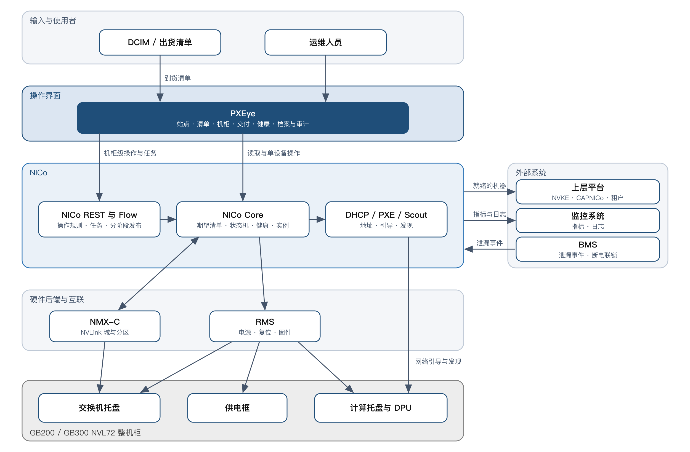
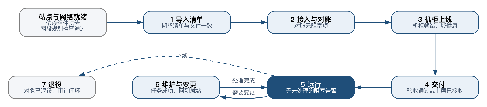
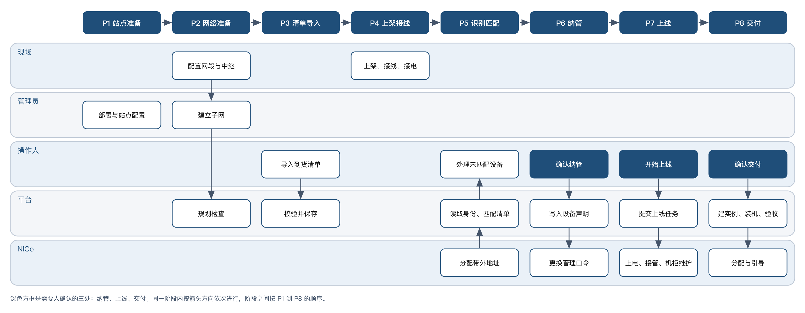
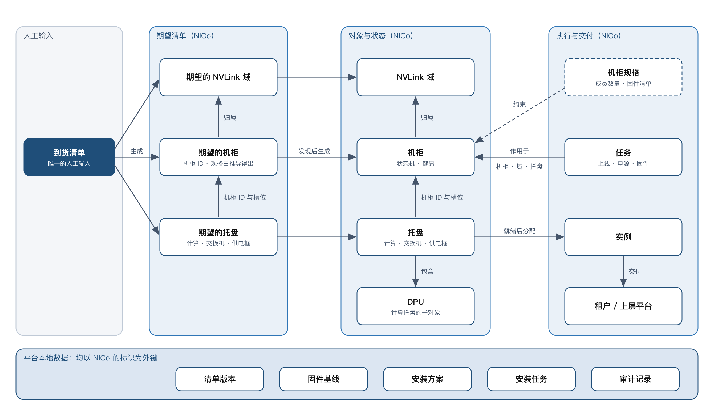
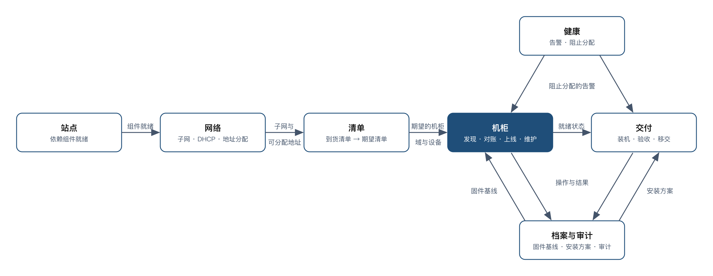

# 机柜级基础设施管理与装机平台设计说明书

[English](whole-rack-operations.md) · **简体中文** · [设计文档](README.zh-CN.md)

基于 NVIDIA Infra Controller（NICo）的 GB200 / GB300 整机柜运维设计。

- 状态：设计稿，用于设计评审。本文描述的是目标设计，不是已实现的功能；本分支的应用代码目前仍是第一版页面。
- 页面层面的设计见[前端设计稿](frontend/README.zh-CN.md)：每个页面可点击，并带功能点说明。

## 1. 文档目的

本文档给出机柜级基础设施管理与装机平台（PXEye）的总体设计：平台架构、整体操作运维流程、模块定位与资源设计、模块间的交互与依赖、操作设计和非功能设计，作为后续接口设计、研发拆解及验收测试的统一依据。

本文档与[需求说明书](../archive/rack-operations-v1/design/rack-operations-requirements.zh-CN.md)的章节一一对应：需求说明书回答“要什么能力”，本文档回答“平台怎么组织这些能力”。目标硬件是 NVIDIA GB200 / GB300 NVL72 整机柜，底座是 NVIDIA Infra Controller（NICo）。

## 2. 设计目标

- 以 NICo 为事实来源和执行引擎：设备写入 NICo 之后，状态以 NICo 为准。平台只补界面、到货清单、设备与清单的匹配和操作门控，不重做 NICo 已有的能力。
- 设备是基础对象，机柜是叠在设备之上的一层。每台设备的地址、状态、固件和单台操作按设备管理；只有必须把整柜当作一个整体才成立的事（上线、整柜的电源与固件、机柜维护）以机柜为操作单位。一个 NVL72 机柜就是一个 NVLink 域。
- 对象、状态和操作的语义与 NICo 一致：机柜上只提供 NICo 在机柜对象上定义的操作；安装操作系统和实例只在单台机器上进行。平台自己增加的内容（按机柜批量发起的设备操作、清单核对、机柜立面）在页面上写明。
- 设备数据只有一份人工输入：到货清单，给出机柜、槽位、序列号和设备凭据。MAC、地址和型号由发现得到；站点级的配置在部署时准备一次，平台逐项核对。
- 每个操作最多三个输入：对象、动作、原因。顺序、超时、重试等由站点级规则决定，不在操作时填写。安装操作系统用到的逐台配置都有默认值，默认情况下只需核对。
- 所有写操作可预览、可跟踪、可审计；结果未知时不自动重发。
- 关键安全联锁留在设施侧，平台不替代，只在检测到风险时拒绝操作。

## 3. 范围与边界

### 3.1 纳入范围

- 机柜、NVLink 域、计算托盘、交换机托盘（NVLink 交换机）和供电框的清单、发现与状态管理；不属于机柜的服务器同样纳入。
- 机柜的纳管与上线，机柜维护进度的跟踪、终止和失败后的重新执行；机柜与设备的上下电和固件更新；设备的维护、隔离、更换和退役；机柜的删除。
- 逐台安装操作系统并验收，以及实例的查看与回收。
- 机柜、域、托盘的健康汇总与告警处理入口。
- 固件基线、安装方案等档案，以及全部写操作的审计。

### 3.2 不纳入范围

- 断路器、冷却阀等设施侧的闭环控制，由楼宇管理系统（BMS）负责。
- 接入交换机、机柜 PDU 等不由 NICo 管理的设备的配置。
- 指标曲线、功率和温度的时序存储与展示，由监控系统负责，平台只提供跳转。
- Kubernetes、SLURM 等集群组装和业务调度。
- 多租户：租户、实例类型与配额的管理，以及 NVLink 逻辑分区的建立。平台使用站点的默认租户逐台建立实例，不向其他平台分发机器。
- 非标准网络环境的适配，不进入主流程。不属于机柜的服务器纳入设备管理和安装，其机型适配不在本文档展开。
- 由 NICo 管理 DPU 的部署方式（DPU 模式）。这一版计算托盘上的 BlueField 只作为网卡使用（网卡模式）；DPU 页面保留并写明支持范围，DPU 模式列入后续阶段，两种方式的差别见 6.3。
- NVLink 域级的电源和固件操作，以及跨机柜的固件分阶段发布。

## 4. 总体架构

### 4.1 分层与职责

| 层 | 组件 | 主要职责 | 关键对象 |
| --- | --- | --- | --- |
| 操作界面 | PXEye | 清单导入、设备身份读取与清单匹配、操作门控、任务跟踪、审计、档案 | 到货清单、暂存的设备凭据、档案、审计、安装任务 |
| 编排 | NICo REST 与 Flow | 按操作规则对机柜级电源和固件操作分步排序，任务持久化；整柜泄漏时自动下电 | 任务、操作规则 |
| 事实与状态 | NICo Core | 设备声明、探测与接管、各类状态机（机柜上线由机柜状态机自动进行）、健康、网段与地址、OS 定义与实例 | 机柜、域、托盘、NVLink 分区、实例 |
| 硬件后端 | RMS（Rack Management Service） | 托盘、交换机、供电框的电源、复位和固件的实际执行 | 硬件协议与逐设备顺序 |
| 互联 | NMX-C | NVLink 域的形成与分区 | NVLink 域、分区 |
| 引导 | NICo DHCP、PXE、Scout | 地址分配、网络引导、硬件发现与准备 | 租约、引导材料 |
| 设施 | BMS、DSX Exchange | 泄漏事件、断路器与冷却阀联锁 | 泄漏事件 |
| 观测 | Prometheus、Grafana、Loki | 指标、日志 | 曲线、日志 |

### 4.2 访问路径

平台用两条路径访问 NICo，规则只有一条：会跨多台设备排序的操作走 Flow 任务，其余走 Core。新机柜的上线任务也走 Flow；交换机就绪之后的机柜维护不由平台提交，由 Core 的机柜状态机自动进行。

| 路径 | 用于 | 原因 |
| --- | --- | --- |
| NICo REST 与 Flow | 新机柜上线、机柜与托盘的上下电和固件、期望与实际校验、任务查询与取消 | Flow 按操作规则排序并持久化任务，平台不自己编排顺序 |
| NICo Core | 全部读取；设备声明；重新执行与终止机柜维护；机柜的删除；单设备的维护标记、隔离、校验、退役；OS 定义与实例 | 单对象操作，没有顺序问题 |

另外有一处不经过 NICo：设备通电拿到地址后，平台用到货清单里的凭据直接读一次设备的 BMC，得到设备类型、序列号和型号，用来匹配清单。除此之外平台不直接访问设备。

### 4.3 依赖组件

| 组件 | 角色 | 是否必需 |
| --- | --- | --- |
| NICo Core、REST、Flow | 底座 | 是 |
| RMS | 整机柜硬件后端 | 是 |
| NMX-C | NVLink 域 | 是 |
| Temporal、PostgreSQL | 工作流引擎与状态存储 | 是 |
| Vault、cert-manager、External Secrets、MetalLB | 凭据、证书、服务地址 | 是 |
| 机柜校验服务（RVS） | 机柜进入就绪前的校验 | 按 NICo 状态机要求 |
| BMS 与 DSX Exchange | 设施侧泄漏事件 | 液冷站点建议 |
| Prometheus、Grafana、Loki | 指标与日志 | 建议 |

平台不配置这些组件的内部参数，只做三件事：部署时按固定清单装上；在站点页检查是否就绪；缺失时把依赖它的操作显示为不可用并说明原因。

## 5. 整体操作运维流程

流程分为两段。第一段是新机柜接入，从站点准备到交付，共八个阶段（P1–P8）；第二段是接入之后的运行期，包括运行、维护与变更、退役（P9–P11）。每个阶段有唯一的编号、责任方、入口条件和出口条件；上一阶段的出口条件未满足时，下一阶段不开始。

新机柜接入过程中有三处需要人确认：纳管、上线、交付。三者相互独立：纳管只把设备登记到 NICo，上线使机柜进入就绪状态，安装操作系统属于交付，按台进行。

本章的流程以整机柜为对象。不属于机柜的服务器只经过其中的 P3 清单导入、P5 识别匹配、P6 纳管和 P8 交付，没有 P7 上线：它逐台确认纳管，在第一次安装操作系统时由 NICo 上电并接管，见 5.4 的 P6 与 P8。

### 5.1 流程总览

| 编号 | 阶段 | 责任方 | 启动方式 | 入口条件 | 出口条件 |
| --- | --- | --- | --- | --- | --- |
| P1 | 站点准备 | 管理员 | 每个站点一次 | 管理集群可用 | 站点页全部依赖组件为就绪，机柜规格已配置 |
| P2 | 网络准备 | 现场、管理员 | 每批机柜一次 | P1 完成 | 规划检查通过 |
| P3 | 清单导入 | 操作人 | 每批机柜一次 | P1、P2 完成 | 清单已保存，机柜规格推导成功，凭据齐全 |
| P4 | 上架接线 | 现场 | 每个机柜一次 | P2 完成 | 机柜已接电，三类管理接口均接入对应网段 |
| P5 | 识别匹配 | 平台、NICo | 机柜接电后自动进行 | P3、P4 完成 | 清单内设备全部匹配，或缺件已确认 |
| P6 | 纳管 | 操作人 | 人工确认 | P5 完成 | 已匹配设备全部登记到 NICo |
| P7 | 上线 | 操作人 | 人工确认，其后自动进行 | P6 完成 | 机柜状态为 Ready，NVLink 域已形成 |
| P8 | 交付 | 操作人 | 人工确认 | P7 完成 | 实例就绪并通过验收 |
| P9 | 运行 | 操作人 | 持续 | P8 完成 | 无未处理的严重告警 |
| P10 | 维护与变更 | 操作人 | 按需 | P7 完成 | 任务成功，机柜回到 Ready |
| P11 | 退役 | 操作人 | 按需 | 设备上无实例 | 设备已退役；成员全部退役的机柜已删除；审计闭环 |

P3 与 P4 没有先后依赖，可以并行。

机柜状态与阶段的对应关系：NICo 中尚无机柜对象对应 P3–P6；Discovering、Maintenance（带所在阶段）、Validating 对应 P7；Ready 对应 P8–P10；Error 需由人排除原因后重新执行机柜维护。页面显示 NICo 的状态原文，阶段只用于导航。

### 5.2 角色与职责

| 角色 | 职责 | 参与阶段 |
| --- | --- | --- |
| 现场 | 机柜的上架、接线与接电；管理交换机上网段与 DHCP 中继的配置 | P2、P4 |
| 管理员 | 平台与依赖组件的部署；站点配置；子网规划 | P1、P2 |
| 操作人 | 清单导入；未匹配设备的处理；纳管、上线、交付的确认；运行期的各项操作 | P3、P5–P11 |
| 平台 | 清单的校验与保存；设备身份读取与清单匹配；设备声明的写入；任务的提交与跟踪；审计 | P2–P11 |
| NICo | 地址分配；设备的探测与接管；上线任务与机柜维护的执行；实例与引导 | P5–P11 |

### 5.3 设备与管理接口

流程中的每项活动都作用于某类设备的某个接口。一个 NVL72 机柜包含三类设备：

| 设备 | 管理接口 | 接入网段 | 用途 |
| --- | --- | --- | --- |
| 计算托盘 | BMC | 带外管理 | 电源控制、硬件信息读取、BIOS 设置 |
| 计算托盘 | 主机网口 | 主机管理 | 主机的网络引导、操作系统安装与系统管理 |
| 计算托盘 | BlueField 的 BMC | 带外管理 | 本版 BlueField 以网卡模式工作，NICo 只探测、不管理 |
| 交换机 | BMC | 带外管理 | 电源控制、硬件信息读取 |
| 交换机 | NVOS 管理口 | 交换机系统管理 | 交换机系统、证书与 NMX-C 的配置 |
| 供电框 | PMC | 带外管理 | 电源控制、状态读取 |

下文把 BMC 与 PMC 统称为管理控制器。各类设备的数量由机柜规格定义。管理交换机与设施侧系统不由 NICo 管理：前者的网段、网关和 DHCP 中继由现场配置，后者负责供电、液冷与泄漏检测。

### 5.4 新机柜接入流程

#### P1 站点准备

- 目的：使平台及其依赖组件可用，并确定站点级配置。
- 责任方：管理员。
- 入口条件：管理集群可用。
- 出口条件：站点页全部依赖组件为就绪，机柜规格已配置。

| 编号 | 活动 | 执行者 |
| --- | --- | --- |
| P1-1 | 部署平台、NICo Core、DHCP 与引导服务 | 管理员 |
| P1-2 | 部署整机柜所需的依赖组件，见 4.3 | 管理员 |
| P1-3 | 配置机柜规格：各类设备的数量与固件清单 | 管理员 |
| P1-4 | 配置站点策略：BlueField 的工作方式为网卡模式；启用交换机 NVOS 凭据入库；设置接管后使用的站点凭据 | 管理员 |

#### P2 网络准备

- 目的：为三类管理接口提供可用的网段与地址。
- 责任方：现场、管理员。
- 入口条件：P1 完成。
- 出口条件：规划检查通过。

| 编号 | 活动 | 执行者 |
| --- | --- | --- |
| P2-1 | 在管理交换机上为带外管理、交换机系统管理、主机管理三个网段配置 VLAN 与网关 | 现场 |
| P2-2 | 为每个网段配置 DHCP 中继，指向 NICo DHCP 的服务地址 | 现场 |
| P2-3 | 在平台中建立三个子网及其 DHCP 地址池 | 管理员 |
| P2-4 | 执行规划检查：每种用途均有子网，可分配地址不少于清单内机柜所需的接口数 | 平台 |

P2-1、P2-2 先于 P2-3：平台只在 NICo 中建立子网，不配置交换机。

#### P3 清单导入

- 目的：建立设备进入 NICo 的依据。
- 责任方：操作人。
- 入口条件：P1、P2 完成。
- 出口条件：清单已保存，机柜规格推导成功，凭据齐全。

| 编号 | 活动 | 执行者 |
| --- | --- | --- |
| P3-1 | 整理到货清单：每台设备一行，包含机柜、槽位、设备类型、序列号 | 操作人 |
| P3-2 | 提供设备凭据：BMC 的用户名与口令；交换机另需 NVOS 的用户名与口令。可按批提供默认值 | 操作人 |
| P3-3 | 导入清单并选择机柜拓扑与厂商；平台推导机柜规格并校验 | 操作人、平台 |
| P3-4 | 确认差异并保存。清单状态为“待匹配” | 操作人、平台 |

到货清单不包含 MAC 与地址。本阶段不向 NICo 写入任何内容。

#### P4 上架接线

- 目的：完成机柜的物理安装，使管理接口接入对应网段。
- 责任方：现场。
- 入口条件：P2 完成。
- 出口条件：机柜已接电，三类管理接口均接入对应网段。

| 编号 | 活动 | 执行者 |
| --- | --- | --- |
| P4-1 | 机柜就位，连接供电与液冷 | 现场 |
| P4-2 | 连接管理线缆：BMC 与 PMC 接入带外管理网段，NVOS 管理口接入交换机系统管理网段，主机网口接入主机管理网段 | 现场 |
| P4-3 | 核对实物与到货清单：机柜编号、槽位、序列号 | 现场 |
| P4-4 | 机柜接电 | 现场 |

本阶段按设备厂商的安装规范执行，平台不参与。

#### P5 识别匹配

- 目的：确定每台已接电的设备对应到货清单中的哪一行。
- 责任方：平台与 NICo 自动完成；操作人处理未匹配的设备。
- 入口条件：P3、P4 完成。
- 出口条件：清单内设备全部匹配，或缺件已确认。
- 约束：只读取设备，不向 NICo 写入，不改变设备。

| 编号 | 活动 | 执行者 | 计算托盘 | 交换机 | 供电框 |
| --- | --- | --- | --- | --- | --- |
| P5-1 | 管理控制器申请地址 | NICo | BMC 从带外地址池获得地址 | BMC 从带外地址池获得地址 | PMC 从带外地址池获得地址 |
| P5-2 | 读取设备身份 | 平台 | 设备类型、序列号、型号 | 设备类型、序列号、型号、NVOS 管理口的 MAC | 设备类型、序列号 |
| P5-3 | 匹配清单 | 平台 | 按序列号对应清单行，得到机柜与槽位 | 同左 | 同左 |
| P5-4 | 处理未匹配的设备 | 操作人 | 认证失败时指定凭据后重试；序列号不在清单时替换清单行或补充清单 | 同左 | 同左 |

BlueField 的 BMC 在本阶段同样获得带外地址，但不单独识别，随所属计算托盘处理。读取身份使用清单中的凭据或批次默认凭据，失败后不逐组尝试其他口令。

#### P6 纳管

- 目的：将已匹配的设备登记到 NICo，由 NICo 接手设备的带外管理。
- 责任方：操作人确认；平台与 NICo 执行。
- 入口条件：P5 完成，操作人已核对匹配结果。
- 出口条件：已匹配设备全部登记到 NICo。
- 约束：不上电，不修改 BIOS，不操作磁盘，不更新固件，不安装操作系统；管理控制器的地址不变。

| 编号 | 活动 | 执行者 | 计算托盘 | 交换机 | 供电框 |
| --- | --- | --- | --- | --- | --- |
| P6-1 | 确认纳管。机柜内的设备按机柜确认一次 | 操作人 | — | — | — |
| P6-2 | 写入机柜级声明：机柜组、机柜、NVLink 域 | 平台 | — | — | — |
| P6-3 | 写入设备声明 | 平台 | BMC 的 MAC、凭据、机柜、槽位；带暂停标记；BlueField 为网卡模式 | BMC 的 MAC、NVOS 管理口的 MAC（标明主口）、BMC 与 NVOS 的凭据、机柜 | PMC 的 MAC、凭据、机柜 |
| P6-4 | 登录管理控制器并更换口令 | NICo | BMC 口令更换为站点凭据 | BMC 口令更换为站点凭据 | PMC 口令更换为站点凭据 |
| P6-5 | 建立设备对象 | NICo | 不建立：暂停标记使 NICo 不上电、不接管 | 建立，等待 NVOS 管理口上线 | 建立并进入 Ready |

机柜确认纳管之后新匹配上的设备，自动执行 P6-3 至 P6-5。

纳管的对象是设备：在 NICo 中每台设备各有一条声明，机柜自身只有 P6-2 的机柜级声明。页面在机柜上提供的“确认纳管”是对该机柜全部已匹配设备的批量发起。不属于机柜的服务器在设备发现中逐台确认纳管，执行 P6-3 至 P6-5 中计算托盘一列的活动，声明中不带机柜；它没有 P7，在 P8 首次安装时由 NICo 上电并接管。

#### P7 上线

- 目的：使机柜进入就绪状态。
- 责任方：操作人确认；上线任务、设备接管与机柜维护由 NICo 执行。
- 入口条件：P6 完成。
- 出口条件：机柜状态为 Ready，三类设备均为 Ready，NVLink 域已形成。
- 约束：不安装操作系统，不建立实例。

上线任务，由操作人提交，按编号顺序执行：

| 编号 | 活动 | 执行者 | 计算托盘 | 交换机 | 供电框 |
| --- | --- | --- | --- | --- | --- |
| P7-1 | 开始上线，提交上线任务 | 操作人 | — | — | — |
| P7-2 | 供电框上电 | NICo | — | — | 上电并确认电源状态 |
| P7-3 | 计算托盘上电并放行接管 | NICo | 上电，解除暂停标记 | — | — |
| P7-4 | 计算托盘固件 | NICo | 版本与期望版本不同时更新 | — | — |
| P7-5 | 交换机上电 | NICo | — | 上电并确认电源状态 | — |
| P7-6 | 核对交换机固件 | NICo | — | 核对版本一致性，不更新 | — |
| P7-7 | 计算托盘重启 | NICo | 重启，使固件生效 | — | — |

设备接管，在设备上电或放行后由 NICo 自动进行：

| 编号 | 活动 | 执行者 | 计算托盘 | 交换机 | 供电框 |
| --- | --- | --- | --- | --- | --- |
| P7-8 | 接管设备 | NICo | 校准 BMC 时钟；设置 BIOS 与启动顺序；从主机管理网段引导发现程序并获得主机管理地址；上报硬件清单；核对硬件；锁定 BIOS；读取实际槽位。按站点策略可能清理全部磁盘 | 关联 NVOS 管理口；配置证书；更换 NVOS 口令并存入密钥库；读取实际槽位；校验 | 已在 P6 进入 Ready |

机柜维护，在就绪的交换机数达到机柜规格要求后由 NICo 自动进行：

| 编号 | 活动 | 执行者 | 计算托盘 | 交换机 | 供电框 |
| --- | --- | --- | --- | --- | --- |
| P7-9 | 固件升级 | NICo | 按机柜规格的固件清单更新；未配置固件清单时跳过 | 同左 | 同左 |
| P7-10 | NVOS 更新 | NICo | — | 更新交换机系统；未配置固件清单时跳过 | — |
| P7-11 | 上电顺序 | NICo | 需要时按顺序重新上电 | 同左 | 同左 |
| P7-12 | 配置 NMX-C 集群 | NICo | — | 配置交换机证书、Fabric Manager、主交换机证书；完成后 NVLink 域形成 | — |
| P7-13 | 机柜校验 | NICo | 站点启用机柜校验时执行 | 同左 | 同左 |

机柜维护的启动条件只有一项：就绪的交换机数不少于机柜规格中的交换机数量。计算托盘与供电框的缺件不影响机柜维护，只产生成员数量不足的告警。机柜维护没有人工确认的开关，阶段顺序不可调整。进行中可以由操作人终止；终止后机柜进入 Error，需重新执行机柜维护。

#### P8 交付

- 目的：给就绪的服务器安装操作系统，使其成为可用的计算资源。
- 责任方：操作人确认；平台与 NICo 执行。
- 入口条件：机柜内的计算托盘要求 P7 完成；不属于机柜的服务器要求 P6 完成。
- 出口条件：实例就绪并通过验收。
- 范围：仅服务器，包括机柜内的计算托盘和不属于机柜的服务器。交换机与供电框在本阶段没有活动。
- 约束：安装按台进行，一台机器建立一个实例。机柜不是安装的对象，只是选择设备时的筛选条件。

| 编号 | 活动 | 执行者 |
| --- | --- | --- |
| P8-1 | 选择设备：可按机柜筛选，可跨机柜选择，也可选择不属于机柜的服务器 | 操作人 |
| P8-2 | 核对每台设备将使用的配置：主机名、安装方案、系统盘、管理地址与启动网卡。配置来自设备管理里的系统配置，没有单独填写的按默认值；需要时逐台修改。本步不做检查 | 操作人 |
| P8-3 | 安装条件检查：平台逐台检查设备身份、安装配置和操作系统材料，全部通过后由操作人确认 | 平台、操作人 |
| P8-4 | 尚未被接管的服务器由 NICo 上电并接管（仅不属于机柜的服务器首次安装时） | NICo |
| P8-5 | 逐台建立实例，实例名称即主机名 | 平台、NICo |
| P8-6 | 服务器从网络引导安装器，将操作系统写入系统盘 | NICo、平台 |
| P8-7 | 验收：核对主机名、系统盘与网络，并重启验证 | 平台 |

主机名同时用作实例名称，安装完成后即系统内的主机名；它不由 NICo 自动分配，没有单独填写时由平台按管理地址生成。管理地址在设备规划时与启动网口的 MAC 对应，本阶段只核对。全部实例建立在站点的默认租户下，页面不显示租户。

### 5.5 设备状态与受到的影响

各阶段结束时三类设备的状态：

| 阶段结束时 | 计算托盘 | 交换机 | 供电框 |
| --- | --- | --- | --- |
| P4 上架接线 | BMC 上电，主机未开机 | BMC 上电 | PMC 上电 |
| P5 识别匹配 | 已匹配，未登记 | 已匹配，未登记 | 已匹配，未登记 |
| P6 纳管 | 已纳管，未上电，NICo 中无设备对象 | 已纳管，设备对象等待 NVOS 管理口上线 | Ready |
| P7 上线 | Ready，可分配 | Ready | Ready |
| P8 交付 | 所选的计算托盘各有一个实例，操作系统已安装 | 不变 | 不变 |

各阶段对设备的影响：

| 阶段 | 电源 | 管理口令 | BIOS | 磁盘 | 固件 | 地址 |
| --- | --- | --- | --- | --- | --- | --- |
| P4 上架接线 | 仅管理控制器上电 | 不变 | 不变 | 不变 | 不变 | — |
| P5 识别匹配 | 不变 | 不变 | 不变 | 不变 | 不变 | 管理控制器的地址确定，此后不变 |
| P6 纳管 | 不变 | BMC 与 PMC 的口令更换为站点凭据 | 不变 | 不变 | 不变 | 不变 |
| P7 上线 | 上电并重启 | NVOS 口令更换 | 计算托盘的 BIOS 被修改并锁定 | 按站点策略可能清理全部磁盘 | 与期望版本不同时更新 | 主机管理地址确定 |
| P8 交付 | 重启 | 不变 | 不变 | 写入系统盘 | 不变 | 不变 |

实际槽位由 NICo 在 P7-8 接管设备后从硬件后端读取，计算托盘与交换机有，供电框没有。因此清单槽位与实际槽位的核对在 P7 之后进行；P6 之前可以核对的只有清单内设备是否出现。

### 5.6 人工确认点

| 确认点 | 所在阶段 | 确认前平台展示的内容 | 确认后自动进行的活动 | 撤回 |
| --- | --- | --- | --- | --- |
| 确认纳管 | P6 | 已匹配的数量、清单核对的差异、待处理的未匹配设备、将执行与不执行的事项 | P6-2 至 P6-5 | 管理口令已更换，不自动还原；交还设备需逐台退役 |
| 开始上线 | P7 | 已纳管的数量、交换机是否到齐、上线任务的步骤、对设备的影响 | P7-2 至 P7-13 | 上线任务可以取消，已完成的硬件动作不撤销；机柜维护可以终止，终止后机柜进入 Error |
| 确认安装 | P8 | 所选设备及每台将使用的配置（主机名、安装方案、系统盘、管理地址），安装条件检查的结果，需要先接管的设备及其磁盘清理范围 | P8-4 至 P8-7 | 删除实例后，设备经清理与重新校验回到可安装 |

### 5.7 运行期流程

| 编号 | 阶段 | 主要活动 | 完成条件 |
| --- | --- | --- | --- |
| P9 | 运行 | 查看机柜、NVLink 域和各类设备的健康与告警，处理标为“需要处理”的条目 | 无未处理的严重告警 |
| P10 | 维护与变更 | 上下电、固件更新、维护标记、隔离、更换托盘；平台检查影响并跟踪任务 | 任务成功，机柜回到 Ready |
| P11 | 退役 | 设备逐台退役：确认无实例，退役并从清单移除。机柜的成员设备全部退役后删除机柜 | 设备已退役；机柜对象已删除；审计闭环 |

运行期各项操作的输入与完成条件见第 9 章。

### 5.8 异常处理

| 阶段 | 异常 | 处理 |
| --- | --- | --- |
| P2 | 规划检查不通过 | 补建缺少的子网，或扩大 DHCP 地址池 |
| P3 | 推导出的机柜规格未配置 | 管理员在站点设置中配置该规格后重新导入 |
| P3 | 清单行缺少凭据 | 在清单行内补充，或提供批次默认凭据 |
| P5 | 设备未获得地址 | 检查设备是否接电、管理线缆是否接入对应网段、该网段的 DHCP 中继是否生效 |
| P5 | 认证失败 | 为该设备指定凭据后重试 |
| P5 | 序列号不在清单中 | 属于出厂替换件时替换清单中的一行；属于清单遗漏时补充清单 |
| P6 | 部分设备写入失败 | 逐台显示原因并可重试；已写入的设备不回退 |
| P7 | 上线任务在某一步失败 | 任务停在该步骤，已完成的硬件动作不撤销；排除原因后重新提交 |
| P7 | 交换机未到齐 | 机柜维护不开始。补齐交换机；确需以更少的交换机上线时，由管理员调整机柜规格中的交换机数量 |
| P7 | 机柜维护在某一阶段失败 | 机柜停在 Error 且不会自行恢复；排除原因后重新执行机柜维护 |
| P7 | 需要中止进行中的机柜维护 | 终止机柜维护；机柜进入 Error，排除原因后重新执行 |
| P8 | 主机名不合规，或与已有实例重名 | 提交前逐台提示，修改后才能进入核对 |
| P8 | 安装条件检查未通过 | 不通过的项目逐条列出设备和原因；修改配置或排除原因后重新检查，通过后才能提交 |
| P8 | 安装或验收失败 | 按安装任务的失败处理，见 6.4 |
| P9 | 整柜泄漏 | NICo 自动对整柜强制下电并拒绝上电；设施侧处理并清除告警后，由操作人提交上电 |

### 5.9 设计前提与待定事项

本流程建立在以下前提之上。前提不成立时，表中所列阶段需要调整。

| 编号 | 前提 | 受影响的阶段 |
| --- | --- | --- |
| A1 | 机柜接电后只有管理控制器上电，设备主电源保持关闭，直到上线任务上电 | P6、P7 |
| A2 | 管理控制器可使用到货清单提供的凭据读取设备类型、序列号与型号 | P5 |
| A3 | 交换机的 BMC 可读出 NVOS 管理口的 MAC | P5、P6 |
| A4 | 管理控制器使用带外地址池动态分配的地址，分配后保持不变 | P5、P6 |
| A5 | BlueField 以网卡模式工作，主机从主机管理网段获得地址 | P2、P7、P8 |

待定事项：上线任务与机柜维护同时进行时的衔接方式。

## 6. 模块设计

平台按职责分七个模块。每个资源只有一个维护入口，其他模块只引用。

| 模块 | 定位 | 拥有的资源 | 对应需求章节 |
| --- | --- | --- | --- |
| 站点 | 平台自身是否可用 | 站点连接、组件就绪状态 | 6.6 |
| 网络 | 各类设备接口用哪个网段，DHCP 是否在工作 | 无本地资源；子网、地址池和地址分配在 NICo | 6.6 |
| 清单 | 到货清单，以及它与 NICo 设备声明的对应 | 清单版本、待匹配的行、暂存的设备凭据 | 6.1、6.2 |
| 机柜与设备 | 设备的状态与单台操作；机柜和 NVLink 域的全生命周期 | 无本地资源，全部在 NICo | 6.1、6.2、6.3、6.4、6.10 |
| 交付 | 给就绪的服务器逐台安装操作系统，管理实例 | 安装任务与验收记录 | 6.5、6.9 |
| 健康 | 当前有什么问题、影响谁、去哪处理 | 无本地资源 | 6.7 |
| 档案与审计 | 可复用的选择项，以及谁做了什么 | 固件基线、安装方案、操作审计 | 6.4、6.8 |

### 6.0 导航

模块说明职责，菜单说明入口。菜单按“对象直达”组织。设备是基础对象：运维人员想看某台交换机的地址、固件或给它上下电时，从菜单直接进入该类设备，不需要先找到它在哪个机柜。机柜是叠在设备之上的一层：机柜页只放 NICo 在机柜对象上定义的内容（状态、上线、整柜的电源与固件、机柜维护、删除）和对成员设备的汇总；成员设备自己的信息和操作在设备页，从设备的“机柜 / 位置”可以回到机柜。安装操作系统按台进行，入口在“安装任务”，不挂在机柜下。

| 菜单分组 | 菜单项 | 子菜单 | 所属模块 |
| --- | --- | --- | --- |
| 运维 | 机柜管理 | — | 机柜与设备 |
| 运维 | NVLink 域管理 | — | 机柜与设备 |
| 运维 | 设备管理 | 服务器、交换机、供电框、DPU | 机柜与设备 |
| 运维 | 健康告警 | — | 健康 |
| 运维 | 运维任务 | — | 机柜与设备 |
| 运维 | 操作审计 | — | 档案与审计 |
| 交付 | 安装任务、实例管理 | — | 交付 |
| 接入 | 网络规划 | — | 网络 |
| 接入 | 设备清单 | — | 清单 |
| 接入 | 设备发现 | — | 机柜与设备 |
| 配置 | 站点设置 | — | 站点 |
| 配置 | 固件基线、安装方案 | — | 档案与审计 |

“接入”三项按使用顺序排列：先规划网段，再导入设备清单，通电后查看设备发现。

菜单有四个分组，只有“设备管理”带子菜单并可以折叠。菜单名用四个字的正式名称，页面标题与菜单名一致。菜单上的数字都表示需要关注的数量。界面上三类设备统称“设备”：服务器、交换机、供电框。服务器可以不属于任何机柜；机柜里的服务器称为计算托盘。

界面文字统一用中文，不把英文缩写和中文拼成一个词：安装方案、交换机、机柜上线、就绪、序列号、开机与关机。保留原文的只有产品与组件名（如 NICo、NVLink、RMS、BMC、DPU），以及 NICo 状态机回报的状态值。

### 6.1 站点

- 展示 NICo Core、Flow、RMS、NMX-C、工作流引擎和存储是否就绪。
- 机柜规格：每种规格应有几台计算托盘、交换机和供电框，以及用哪份固件清单。它是 NICo 的站点配置，NICo 没有修改它的接口；管理角色在这里调整，平台据此更新 NICo 的站点配置并滚动重启 NICo。交换机的数量是机柜维护开始的最低门槛。
- 子网、DHCP 和引导服务地址不在站点里维护，见 6.7 网络。
- 自动化流程说明：有些事是系统自己做的，操作人看不到过程。用一张表按场景写明什么时候开始、系统会自动做什么、需要人做什么，包括机柜接电、新机柜上线、上电、下电与重启、固件更新和整柜泄漏。只读。
- 固件什么时候会被更新：只有两种时候，新机柜上线（机柜规格配了固件清单时）和人提交固件更新。平时不会自动更新，设备版本与基线不同只标出来。
- 某个组件未就绪时，依赖它的操作在全平台显示为不可用并说明原因。

### 6.2 清单

- 到货清单是设备数据唯一的人工输入，来源是 DCIM 或出货清单。一张表，一行一台设备，覆盖三类托盘。
- 清单给出设备类型、序列号和设备凭据，机柜里的设备另有机柜和槽位；不要求 MAC 和地址：出货清单通常没有 MAC，MAC 在设备通电后从 DHCP 得到。
- 不属于机柜的服务器也在清单里，机柜和槽位留空。它按同样的方式匹配，纳管在设备发现里逐台确认。交换机和供电框必须属于机柜。
- 清单的一行有三种状态。导入后是“待匹配”，只保存在平台里，因为 NICo 的设备声明以 BMC 的 MAC 为键。设备通电、平台读出序列号并对上这一行后是“已匹配”，这时仍然没有写入 NICo。确认纳管之后（机柜里的设备按机柜确认，不属于机柜的服务器逐台确认），声明连同 MAC、凭据、机柜和槽位写入 NICo，这一行变为“已纳管”。纳管只是登记，设备不上电，也不装系统。
- 导入是整表差异：显示新增、变更、移除，确认后保存；移除有实例或进行中任务的设备会被拒绝。
- 机柜规格由导入时选择的机柜拓扑和机柜厂商推导。机柜拓扑是 NICo 对一种机柜硬件布局的命名（例如 gb200_nvl72r1_c2g4）；可选的值读自 NICo 已配置的机柜规格，平台不维护这张表。NICo 没有配置推导出的规格时，在导入预览里报错。
- 设备凭据：一台设备的凭据取行内的值，行内留空时取导入时填写的批次默认值。交换机除了 BMC 的凭据，还要 NVOS 的凭据。口令只提交一次，加密暂存，页面、版本记录和审计里都不出现；声明写入 NICo 后交给 NICo，平台不再保存。
- 清单文件保留版本，保存前去掉口令。

到货清单的列：

| 列 | 说明 | 必填 |
| --- | --- | --- |
| rack | 机柜 ID，用 DCIM 的编号 | 机柜内的设备必填 |
| slot | 机柜内槽位 | 机柜内的设备必填 |
| type | compute、switch、power_shelf | 是 |
| serial | 设备序列号，匹配设备的唯一依据 | 是 |
| location | 机柜的物理位置 | 否 |
| management_ip | 服务器规划的管理地址，只用于服务器；设备被发现后与启动网口的 MAC 对应 | 否 |
| bmc_user、bmc_password | 设备 BMC 的用户名和口令；留空时用批次默认值 | 否 |
| nvos_user、nvos_password | 交换机 NVOS 的用户名和口令；留空时用批次默认值 | 否 |

导入时另外选择：机柜拓扑和机柜厂商（两者一起决定机柜规格），以及批次默认凭据。

### 6.3 机柜与设备

设备是基础对象，机柜是叠在设备之上的一层。同一批对象有两种进入方式：按设备进入直接运维，按机柜进入看整柜。分工有三条规则：

- 设备的地址、状态、固件和单台操作只在设备页维护；机柜页只引用和汇总，点击进入设备页。
- 机柜页只提供 NICo 在机柜对象上定义的操作，以及机柜的状态、健康和规格。
- 平台自己增加的内容在页面上写明：按机柜批量发起的设备纳管、清单核对、机柜立面。

| 视图 | 回答的问题 | 内容 |
| --- | --- | --- |
| 机柜 | 每个机柜处在流程的哪一步，它有哪些成员 | 机柜列表；机柜详情里是确认纳管、开始上线、机柜维护进度、清单核对、机柜立面、任务、健康与历史，以及机柜级操作 |
| NVLink 域 | 域有没有形成，划了哪些分区 | 每个域的 NMX-C 是否连通、域健康、Fabric Manager 正常的交换机数，以及 NVLink 分区。只读 |
| 设备 | 我要找的这台设备怎么样 | 跨类型搜索（序列号、地址、MAC、实例）；需要处理的设备 |
| 服务器、交换机、供电框 | 这一类设备的地址、状态、固件，哪些有问题 | 各自的列表，地址和固件版本直接在表里；行上直接上下电和操作，支持批量。服务器页同时列出机柜里的计算托盘和不属于机柜的服务器 |
| DPU | 每块 BlueField 卡是什么工作方式，和策略是否一致 | 只读列表：序列号、所属计算托盘、BMC 地址、策略、实际工作方式、网卡固件；写明这一版只支持网卡模式 |
| 设备发现 | 清单里的设备接入到哪一步，哪些匹配不上 | 待处理的端点和处理入口；清单里每一行的进度 |
| 任务 | 机柜级的电源和固件操作执行到哪了 | 全部 Flow 任务的步骤与结果 |

- 默认首页是机柜。机柜列表包含清单里的全部机柜；NICo 里还没有对象的机柜显示为“尚未建立”。机柜对象不由人工创建，它的第一台成员设备被接管时由 NICo 生成。
- 一个 NVL72 机柜就是一个 NVLink 域，所以没有域级的电源和固件操作。域有两个编号：清单里的机柜组编号，和机柜上线后 NMX-C 回报的域编号，页面两个都显示。域和分区都不在这一页维护：域按到货清单里的机柜自动声明；逻辑分区不在这一版平台里建立，NICo 中已有的分区在这里只读显示；对应的 NMX 分区在第一个实例加入时由 NICo 自动建立。
- 新机柜的识别匹配、纳管与上线按 5.4 的阶段定义进行，各阶段对设备的影响见 5.5，人工确认点见 5.6。页面入口的对应关系：未匹配设备在“设备发现”处理；确认纳管与开始上线在机柜详情，各有一张卡片，分两栏列出将执行与不执行的事项；上线任务的进度在机柜详情的任务页签，机柜维护的进度在机柜详情上方单独显示。
- 清单核对：两类差异。一是清单里有、但还没有设备读出这个序列号的行；二是实测的槽位和清单写的不同：实测槽位是 NICo 接管设备后向硬件后端 RMS 查询得到的，RMS 读自托盘的 BMC；计算托盘和交换机有，供电框没有，而且要到上线之后才有。清单核对帮人看清情况，不拦截上线：交换机没到齐时机柜维护不会开始，计算托盘和供电框缺件、槽位不一致都不影响。交换机的数量是机柜维护开始的最低门槛，写在机柜规格里；确实要以更少的交换机上线，由管理员在站点设置里调整这个规格的数量。
- 机柜级操作：开始上线、上电、下电、重启、固件更新、期望与实际校验、机柜维护进行中的终止和停在 Error 时的重新执行，以及删除机柜。这是 NICo 在机柜对象上定义的全部写操作。机柜上没有安装操作系统和建立实例的操作。机柜对象没有电源状态，页面显示成员里有几台开机。
- 确认纳管：纳管是逐台设备的登记。机柜详情里的“确认纳管”是对本机柜全部已匹配设备的批量发起，同时写入这个机柜的机柜级声明。
- 删除机柜：只删除机柜对象，不处理成员设备。前提是机柜上没有实例、成员设备都已逐台退役、没有进行中的任务；页面逐项显示这些前提是否满足，未全部满足时不能提交。
- 设备级操作：上电、关机、重启、固件更新、维护标记、隔离、按需硬件校验、重启 BMC、更换、退役。各类型可用的动作不同，都用同一个操作对话框。退役是逐台设备的操作，三类设备都有。
- 系统配置：一台服务器下次安装时使用的配置。可以修改的只有三项：主机名、安装方案、系统盘，每一项都有默认值：主机名按管理地址生成，安装方案用该架构的默认方案，系统盘按方案的选盘规则。管理口（启动网卡和管理地址）在设备规划时对应好，这里只显示，不修改；其他网口平台不管理，也不显示。系统配置归设备页维护，安装任务只引用。
- 不属于机柜的服务器：只在设备页出现，“机柜 / 位置”显示“未分配机柜”。它没有上线这一步：在设备发现里逐台确认纳管，纳管后不上电，第一次安装操作系统时由 NICo 上电并接管。
- 设备运行状态：运行状态、健康告警、固件与基线的对比、状态时间线；计算托盘另有实例、DPU、硬件能力和 LLDP 邻居；交换机另有 NVOS 管理口和 Fabric Manager。供电框没有可读的固件版本和供电参数，只显示地址、状态、健康和电源。
- DPU 的两种方式。NICo 对每台主机有一个 DPU 策略，站点有默认值，单台主机可以在声明里覆盖：网卡模式下 BlueField 当普通网卡用，NICo 只探测它，主机从主机管理网段获得地址，交付用不经 DPU 的网络；DPU 模式下每块卡是一台由 NICo 管理的设备，有自己的系统和固件，主机的地址和租户网络经它提供。这一版平台写入的策略都是网卡模式，接入、网络规划和交付都按网卡模式设计。以后支持 DPU 模式时，策略成为清单里的一列，DPU 页面增加每块卡的运行状态和与主机的配对，网络规划增加 DPU 自身和主机经 DPU 使用的网段，交付改用经 DPU 的网络。
- 待定：上线任务与 NICo 自动的机柜维护同时进行时如何衔接，实测后确定。

### 6.4 交付

- 交付的对象是服务器，按台进行：一台机器建立一个实例。机柜不是交付的对象，只是选择设备时的筛选条件；可以跨机柜选择，也可以选择不属于机柜的服务器。
- 入口是“安装任务”里的“新建安装任务”。机柜详情、服务器列表和设备发现里的同名入口打开同一个向导，只是预先选好了设备。
- 向导分三步：选择设备，核对配置，检查并确认。选择设备和安装条件检查沿用现有产品的安装向导，包括页面和检查项。每批最多 50 台。
- 核对配置只做核对，不做检查。它是一张列表，一台一行，列出主机名、安装方案、管理地址与启动网卡、系统盘；这些来自设备管理里的系统配置（见 6.3），都有默认值，按默认值得到的项目标明“默认”。默认情况下操作人不需要填写，看一遍即可进入下一步。要修改某一台，点它打开系统配置，保存后回到列表。
- 主机名同时是实例名称，安装完成后是系统内的主机名。没有单独填写时按管理地址生成，例如管理地址 198.51.100.78 生成 node-198-51-100-78；提交前检查写法和重名。
- 网络只做核对：列表里只显示管理口，即管理地址和启动网卡，它们在设备规划时已经对应好，不在这里修改。其他网口平台不管理。
- 可以安装的条件：机器就绪、没有实例、没有隔离和维护标记、没有“阻止分配”的告警；机柜里的设备另外要求机柜 Ready、没有整柜泄漏、没有进行中的任务。不满足的原因逐台显示在“安装条件”一列，一台设备的问题不影响同柜的其他设备，平台不提供绕过。
- 选择设备时可以按需查询“当前系统”。查询只读，用来在覆盖系统盘之前确认设备上现在是什么。
- 安装条件检查单独作为第三步，因为它要登录每台设备的 BMC、核对地址占用和安装材料，比较耗时；放在核对之后，修改配置时不会反复触发。检查逐台进行，分三组。设备身份：BMC 认证与序列号。安装配置：机器就绪且没有实例、主机名与安装方案、管理地址与地址占用、系统盘。操作系统材料：安装材料可以取到，长度与登记一致。任何一台的任何一项不通过，整批不能提交；不通过的项目逐条列出设备、检查名和原因。
- 系统盘按安装方案的选盘规则解析，必须解析出唯一的一块盘。解析不出时在核对配置的列表里就标出来，在这台设备的系统配置里指定系统盘后才能进入检查。
- 安装方案按设备的架构匹配已发布的方案，没有单独选择时用该架构的默认方案；系统盘默认按安装方案的规则选择，个别设备可以在系统配置里指定。
- 配置没有改动时，从核对配置回到第三步沿用上一次的检查结果，不重新检查；可以手动重新检查。检查通过只表示当时可以执行：提交时服务端再检查一次配置和占用，执行前另做安装材料的完整摘要校验。
- 不属于机柜的服务器，纳管后尚未被接管的也可以安装：安装任务的第一步由 NICo 上电并接管它，随后才写系统盘。它的“机器就绪”和“系统盘”两项推迟到执行前确定，不算检查失败；首次接入会清理全部磁盘，包括非系统盘，确认时要另外勾选。
- 装机走 NICo 的 DHCP、PXE 和模板化 OS。一次提交是一个批次，安装过程和验收结果按台保存。
- 全部实例建立在站点的默认租户下，页面不显示租户；平台不向其他平台分发机器。
- 释放走 NICo 的清理与重新校验流程，清理完成前不能再次安装。

### 6.5 健康

- 汇总机柜和三类托盘当前的健康告警，按告警或按对象分组，标出“阻止分配”和“整柜泄漏”两类。告警的编号和分类用 NICo 的原文。
- “需要处理”只使用 NICo 的信号：状态机处理失败、存在健康告警。
- 没有收到报告显示为“未报告”，不显示为健康。
- “阻止分配”只影响它所在的那台主机：这台主机不会分配给新的实例。带维护标记的主机也属于这一类。它不代表整柜有问题。
- 泄漏分两级。托盘级由设备的传感器报告。机柜级泄漏时，NICo 自动对整柜全部设备强制下电，并拒绝再次上电；告警清除后设备不会自动开机。页面如实显示这次自动下电和受影响的实例。未接入设施侧事件时在站点页提示。
- 机柜成员数量少于机柜规格时有一条机柜级告警，按设备类型计数，不指明槽位，也不阻止分配。
- 曲线、功率和温度跳转到监控系统，页面不重做。

### 6.6 档案与审计

- 固件基线：绑定机柜规格的一组版本，对应站点为这个规格配置的固件清单。固件更新只能选择基线，不能填写任意版本。NICo 只能判断设备的版本与基线是否相同，不能判断高低；NVOS 和供电框没有可读的已安装版本。提交固件更新时，版本已经相同的设备会跳过。
- 安装方案：可复用的系统、磁盘与登录默认值，按架构区分。安装任务只能选择已发布、架构与设备一致的方案；逐台不同的内容不写在方案里。
- 审计：每次写操作记录操作者、对象、动作、原因、任务编号和读回结果；只追加，不删除。
- 角色：只读不能执行操作；操作可以执行设备、机柜和安装操作；管理另外可以修改站点、网络和安装方案。接入站点的身份系统后审计记录到人。

### 6.7 网络

网段要在导入设备清单之前规划好。设备通电后按规划获得地址，才能被发现。

各类设备的接口对应三种用途，每种用途至少有一个子网：

| 用途 | 适用的设备接口 | NICo 网络类型 | 说明 |
| --- | --- | --- | --- |
| 带外管理 | 计算托盘 BMC、交换机 BMC、供电框 PMC、DPU BMC | Underlay | 设备发现的入口：这些接口拿到地址后，平台读取设备身份 |
| 交换机系统管理 | 交换机 NVOS 管理口 | Underlay | 交换机接管后的配置与管理 |
| 主机管理 | 计算托盘主机网口 | HostInband | 主机的网络引导、装机和系统管理 |

- 规划检查：每种用途都有子网，可分配地址不少于需要的数量。需要的数量按接口计算，不按设备台数：每台设备一个 BMC，每台交换机另有两个 NVOS 管理口，每块 DPU 的 BMC 也各占一个。检查不通过时不能导入设备清单；导入预览把新机柜算进去。
- 子网：名称、用途、前缀、网关、DHCP 地址池、已分配与可分配。已创建的子网只允许调整 DHCP 地址池。用途和交换机侧 VLAN 是平台记录的，NICo 的子网没有这两项。子网所属的 DNS 域由平台自动填站点的默认域，不需要选也不显示；只有站点配置了多个 DNS 域时，新增主机管理子网才要选一个。
- DHCP 服务：整机柜站点只使用 NICo DHCP。按子网显示最近一次给出地址的时间和地址池使用量；一直没有给出过地址的子网标出来。引导服务地址（网络引导、安装材料、DNS、NTP）在这里维护。
- 地址什么时候定：BMC 的地址在机柜接电时从地址池分配，纳管和上线都不改变它；主机管理地址在计算托盘上线、第一次从网络启动时分配。按规划给 BMC 指定固定地址不在这一版：那要求设备第一次申请地址之前就有带地址的声明，而到货清单不带 MAC。
- 地址分配：每个地址分给了哪台设备的哪个接口，以及 NICo 回报的分配方式（动态分配、固定地址、保留）。分配方式是逐台设备决定的，不是子网的属性，也不手工指定。还没有归属的地址在设备发现里处理。
- 平台只在 NICo 里创建子网和地址池，不配置交换机。每个网段的 VLAN、网关和 DHCP 中继是现场前提。

## 7. 核心资源与状态模型

### 7.1 资源与归属

| 资源 | 来源 | 标识 | 维护入口 |
| --- | --- | --- | --- |
| 到货清单 | 人工导入 | 文件版本；每行以序列号为标识 | 清单 |
| 设备凭据 | 到货清单或批次默认值 | — | 清单；声明写入 NICo 后平台不再保存 |
| 设备声明（机柜组、机柜、设备） | 设备按序列号匹配上清单、确认纳管后，由平台写入 NICo | 机柜 ID、BMC MAC、序列号 | 机柜（按机柜确认纳管）、设备发现（不属于机柜的服务器逐台确认） |
| 机柜 | 第一台成员设备被接管时由 NICo 生成 | 机柜 ID | 只读；操作在机柜与设备模块 |
| NVLink 域 | NICo 与 NMX-C | 机柜组编号；NMX-C 回报的域编号 | 只读 |
| NVLink 分区 | NICo | 分区 ID | 只读 |
| 服务器（含计算托盘）、交换机、供电框 | NICo 发现与接管 | NICo 对象 ID、序列号 | 只读；操作在机柜与设备模块 |
| DPU（BlueField 卡） | NICo 探测 | 序列号 | 只读 |
| 机柜规格 | NICo 的站点配置，由清单里的机柜拓扑和厂商推导 | 规格 ID | 只读 |
| 任务 | Flow | 任务 ID | 机柜与设备模块的任务视图 |
| 实例 | 新建安装任务时逐台建立 | 实例 ID；实例名称即主机名 | 交付 |
| 固件基线、安装方案 | 档案 | 名称与版本 | 档案与审计 |
| 审计记录 | 平台 | 记录 ID | 只读 |

关系规则：

- 归属只有一个键：机柜 ID。匹配设备只有一个依据：序列号。期望的槽位来自到货清单，实测的槽位由 NICo 在接管设备后从硬件后端读到，上线之后两者在清单核对里比对。
- 设备通过各自的机柜 ID 归属机柜，机柜对象里不保存成员。机柜 ID 是可选的：不属于机柜的服务器没有机柜 ID。一个 NVL72 机柜对应一个 NVLink 域。
- 实例与机器一一对应，实例不归属机柜。
- 任务是上线、机柜级电源和固件操作的执行记录；NICo 自动的机柜维护记在机柜的状态历史里。审计记录谁、何时、为何提交了哪个任务。
- 平台本地只保存清单版本、待匹配的清单行、暂存的设备凭据、档案、安装任务和审计。写入 NICo 之后的数据以 NICo 的标识为外键。

### 7.2 状态

页面显示 NICo 状态机回报的状态原文，不另外定义状态名。

| 对象 | 状态 | 状态转换触发 |
| --- | --- | --- |
| 机柜 | 尚未建立（只在清单里）、Discovering、Maintenance（固件升级、NVOS 更新、上电顺序、配置 NMX-C 集群）、Validating、Ready、Error、Deleting | 上线任务上电后第一台设备被接管；交换机就绪数达标后自动进入机柜维护；各阶段完成；校验结果；任一阶段失败或操作人终止机柜维护进入 Error；重新执行机柜维护 |
| 托盘 | NICo 各类托盘状态机的状态 | 发现、接管、校验、分配、释放、故障、退役 |
| 任务 | 等待、执行中、成功、失败、已终止 | 提交、步骤完成、步骤失败、取消 |
| 实例 | NICo 实例生命周期状态 | 分配、装机、就绪、释放 |

## 8. 模块交互与依赖

### 8.1 模块依赖

| 上游 | 下游 | 传递什么 | 门控 |
| --- | --- | --- | --- |
| 站点 | 网络 | 组件就绪状态 | 站点未就绪时不能创建子网 |
| 网络 | 清单 | 各用途的子网与可分配地址 | 规划检查不通过时不能导入 |
| 站点 | 清单 | 支持的机柜规格 | 站点未就绪时不能导入 |
| 清单 | 机柜与设备 | 清单里的机柜和设备 | 清单里的机柜和设备都出现，不论 NICo 里有没有对象 |
| 档案 | 机柜与设备 | 固件基线 | 固件更新只能选基线 |
| 机柜与设备 | 交付 | 服务器的就绪状态；机柜里的另有机柜的就绪状态 | 机器未就绪时不能安装；机柜非 Ready 时柜内的设备不能安装 |
| 档案 | 交付 | 安装方案 | 只能选已发布的方案 |
| 健康 | 机柜与设备、交付 | 整柜泄漏、阻止分配 | 整柜泄漏时拒绝上电，柜内的设备不能安装；带阻止分配告警的服务器按台排除 |
| 机柜与设备、交付 | 审计 | 每次提交的操作与结果 | 审计写入失败时操作不提交 |

### 8.2 互斥规则

- 同一机柜同一时间只有一个进行中的任务。正在上线的机柜不接受电源和固件任务。
- 托盘上有实例或进行中的安装任务时，会中断该托盘的操作要先显示受影响的实例并要求确认；交换机和供电框的操作按整柜实例计算影响。

### 8.3 外部依赖缺失时的行为

| 缺失 | 影响 | 页面行为 |
| --- | --- | --- |
| Flow | 新机柜上线、机柜级上下电、固件更新、任务；整柜泄漏时的自动下电 | 这些操作不可用并说明原因；读取、纳管与单设备操作照常 |
| RMS | 托盘、交换机、供电框的电源与固件；机柜上线与机柜维护 | 上线、电源与固件操作不可用；正在做机柜维护的机柜停在 Error，RMS 恢复后要重新执行机柜维护 |
| NMX-C | NVLink 域形成与分区 | 域显示为未形成；机柜到不了 Ready，柜内的设备不能安装 |
| 设施侧事件 | 设施侧泄漏事件 | 只显示托盘传感器的泄漏；站点页提示未接入 |

## 9. 操作设计

所有写操作同一个形态：选对象，选动作，写原因。新建安装任务和服务器的系统配置是例外：安装任务用三步向导选择设备、核对每台的配置、检查并确认，配置本身在系统配置里逐台维护，见 6.3 与 6.4。

| 操作 | 对象 | 输入 | 完成条件 |
| --- | --- | --- | --- |
| 导入清单 | 站点 | 文件、机柜拓扑与厂商、批次默认凭据 | 清单已保存 |
| 指定凭据重试 | 待处理的端点 | 用户名与口令 | 读到序列号并匹配上清单 |
| 替换清单中的一行 | 待处理的端点 | 清单里的一行 | 这一行已匹配 |
| 确认纳管 | 一个机柜内全部已匹配的设备；或一台不属于机柜的服务器 | 无 | 设备登记到 NICo，设备未上电 |
| 开始上线 | 已纳管的机柜 | 无 | 上线任务成功，机柜 Ready |
| 重新执行机柜维护 | 停在 Error 的机柜 | 无 | 机柜 Ready |
| 终止机柜维护 | 处于维护阶段的机柜 | 无 | 机柜进入 Error |
| 上电、下电、重启 | 机柜、托盘 | 动作 | 任务成功且电源状态读回一致 |
| 固件更新 | 机柜、托盘 | 固件基线 | 任务成功且版本与基线相同 |
| 期望与实际校验 | 机柜、托盘 | 无 | 无差异 |
| 维护标记、隔离 | 托盘 | 原因 | 读回一致 |
| 按需硬件校验 | 计算托盘 | 无 | 校验记录完成 |
| 修改系统配置 | 一台服务器 | 主机名、安装方案、系统盘；都有默认值 | 已保存，下次安装生效 |
| 新建安装任务 | 一台或多台服务器 | 无；核对每台的系统配置 | 每台的实例就绪并通过验收 |
| 更换托盘 | 托盘 | 新设备的序列号与凭据 | 新设备被接管，机柜回到 Ready |
| 退役 | 设备 | 原因 | 设备已退役 |
| 删除机柜 | 没有实例、成员设备都已退役的机柜 | 无 | 机柜对象已删除 |

交互规则：

- 确认页只显示四项：对象、动作、受影响的实例数、将经过的步骤。高风险动作要求输入机柜 ID 或序列号。
- 会中断业务的电源和固件任务不是提交后立刻执行：任务先等受影响的主机可以操作，每 5 秒检查一次，最多等 30 分钟，等不到就失败。确认页写明现在有几台主机不满足、原因是什么，以及提交后依次会发生什么；任务里“等待主机就绪”是单独的一步。
- 提交后进入任务视图。任务在某一步失败后停止，不撤销已完成的硬件动作，页面不承诺回滚。
- 取消任务是尽力而为：不再开始新的步骤，已经交给硬件后端的动作不会停。
- 结果未知时先读回，不自动重发，下一步由操作人决定。
- 不提供的入口：任意固件版本输入、强制跳过检查、逐机超时与并发、直接的硬件协议操作。

## 10. 非功能设计

- 安全联锁：断路器和冷却阀的联锁归设施侧；整柜泄漏时 NICo 自动强制下电整柜并拒绝上电，操作人不能跳过。
- 影响范围：按机柜计算。一台交换机或供电框的操作影响整柜全部实例，确认页必须显示受影响实例数。
- 固件一致性：固件更新的推荐单位是机柜，一个机柜就是一个 NVLink 域；对单托盘更新时提示柜内版本差异。
- 安装门控：NICo 建立实例时只检查机器自身；机柜是否就绪、有无整柜泄漏由平台在选择设备时检查。平台只显示原因，不提供绕过。
- 凭据：设备口令只在导入清单时提交一次，加密暂存；页面、版本记录和审计里都不出现。声明写入 NICo 后口令交给 NICo，平台不再保存；接管后由 NICo 轮换。读取设备身份时不逐组尝试口令。
- 可靠性：任务由 Flow 持久化，平台重启不丢任务；升级前检查没有进行中的任务。
- 备份：NICo 的数据库与凭据存储必须备份；到货清单文件按版本保存。
- 规模：默认视图是机柜的聚合，列表不逐行调用接口。
- 透明：站点页用一张表写明各种情况下 NICo 怎么处理；每个会自动发生的动作（上线、整柜泄漏时下电）在页面上都看得到起因和经过。
- 可观测性：页面只做当前状态和处理入口，时序数据交给监控系统。
- 交付形态：平台与全部依赖作为一个带版本锁的离线包交付。

## 11. 建设分期

| 阶段 | 建设重点 | 阶段性成果 |
| --- | --- | --- |
| 一期：清单与接入 | 站点检查、网络规划、到货清单导入、设备发现与清单匹配、纳管、健康汇总 | 从导入清单到设备全部纳管，不使用命令行 |
| 二期：机柜生命周期 | 上线、机柜维护进度与重新执行、上下电、固件更新、任务视图、审计 | 在页面上完成机柜上线，并完成一次完整的维护 |
| 三期：交付 | 逐台安装与验收，服务器的系统配置及其默认值，安装条件检查，释放与复用 | 一个机柜的全部计算托盘和一台不属于机柜的服务器完成安装 |
| 四期：规模化 | 跨机柜的固件分阶段发布、身份系统与角色、DPU 模式 | 多机柜的变更可控、可追责 |

## 12. 验收原则

1. 以流程闭环为主线验证：从导入清单到安装完成，再到一次维护和一次更换，全程不使用命令行。
2. 以状态和读回为准：每个操作有明确的完成条件，成功以 NICo 读回的状态为准，不以请求被接受为准。
3. 以故障优先验证：重点覆盖缺件、认证失败、清单外的设备、上线停在 Error、固件失败、任务中断、整柜泄漏和依赖组件不可用。
4. 以简单为准：每个操作的输入不超过对象、动作、原因；出现第四个输入时回到设计评审。
5. 以可审计为准：每次写操作都能查到操作者、对象、原因、任务和结果。
6. 记录三项指标：通电到机柜 Ready 的时间、人工处理的端点数、每次维护的人工步骤数。

## 13. 参考资料

- NVIDIA Infra Controller 文档：https://docs.nvidia.com/infra-controller/documentation/home
- Key Capabilities：https://docs.nvidia.com/infra-controller/documentation/overview/key-capabilities
- Day 0, Day 1, and Day 2 Lifecycle：https://docs.nvidia.com/infra-controller/documentation/overview/day-0-day-1-day-2-lifecycle
- Rack, Machine, Switch, Power Shelf 状态机：https://docs.nvidia.com/infra-controller/documentation/architecture/state-machines/rack-machine-switch-power-shelf
- NICo 源码：https://github.com/dsx-ai-factory/infra-controller
- Rack Management Service 文档：https://docs.nvidia.com/rms/documentation/home/
